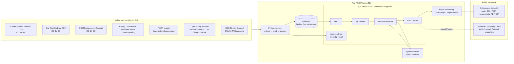

# 02 — Technical Requirements: Malaysia Energy Transition Dashboard

**Status:** Approved 2026-09-30 · **Updated:** 2026-09-30 · **Builds on:** [01 PRD](01_Product_Requirements.md) (Approved 2026-09-30) · **Next:** 03 App Flow

> Labels: **Decided** = settled by you. **Recommended** = Claude's proposal, which you can change. **Unverified** = not yet confirmed against a real source. Nothing in this document is installed yet unless it says **Installed**.

## 1. Architecture overview

A local **batch pipeline** (no server, no cloud database). Python pulls the public sources, SQL Server stores and models them in layers, and Power BI reads the modelled layer. The forecast is a Python step that writes its results back into SQL Server. The post-v1 web showcase reads exported snapshots, not the live database.

**Key design choices**
| Choice | Why | Label |
|---|---|---|
| Layered database: `raw` → `stg` → `dw` → `mart`, plus `meta` | Mirrors the raw/staging/warehouse pattern hiring managers expect. Covers FR-04 and keeps every number traceable to its source row. | Recommended |
| Power BI in **Import** mode, not DirectQuery | Data is small (hundreds of thousands of rows at most). Import is faster (NFR-01) and lets DAX do time intelligence. | Recommended |
| Report saved as **PBIP** (PBIR report + TMDL model) | Text files that Git can diff, and Claude can read and edit them. PBIP and PBIR are GA, and PBIR became the default report format in Sept 2026 ([MS Learn](https://learn.microsoft.com/en-us/power-bi/developer/projects/projects-overview), [Power BI blog](https://powerbi.microsoft.com/en-gb/blog/pbir-will-become-the-default-power-bi-report-format-get-ready-for-the-transition/)). Meets NFR-07. | Recommended |
| Forecast written back to `dw.fact_load_forecast` | Power BI shows actual vs forecast from one model. The ML step stays reproducible and testable. | Recommended |
| Source adapters behind one interface | Each source (Ember, OWID, DOSM, handbook, hourly demand) is its own module. The GSO adapter can be switched on later without redesign, per your "ask TNB now + open fallback" decision. | Recommended |

## 2. Mobile
Not applicable. The deliverables are a desktop Power BI report, a GitHub repo and (post-v1) a responsive Streamlit page viewable on phones. None is a native mobile app.

## 3. Frontend

### 3.1 v1: Power BI report
- **Tool:** Power BI Desktop. **Installed**: Microsoft Store package `Microsoft.MicrosoftPowerBIDesktop` 2.158.1177.0, so it auto-updates. Not signed in yet; Desktop works fully without sign-in, which is only needed for FR-19 (Publish to web).
- **Pages:** six (doc 01 §4). Layout and theme are defined in doc 04; navigation in doc 03.
- **Theming:** one custom report theme JSON, committed to the repo, with a colour-blind-safe palette validated by the `dataviz` skill (NFR-04).
- **Model:** star schema imported from `mart.*` views. DAX measures live in a dedicated `_Measures` table, with a display folder per page. Formats and units are set on measures, not visuals.
- **Exports for non-Power-BI viewers (FR-17):** PNG per page, a PDF export from Power BI Desktop (File → Export → PDF), and a ≤2-min GIF/MP4 walkthrough recorded with Windows' built-in Snipping Tool screen recorder (**Recommended**).

### 3.2 Post-v1: web showcase (FR-21)
- **Framework:** Streamlit (**Recommended**: you already run HA-PIT on Streamlit Community Cloud). Charts with Plotly.
- **Data:** Parquet snapshots exported from `mart.*` and committed to the repo, only for openly licensed sources (and Energy Commission or GSO data only if consent is granted).
- **Hosting limits:** apps sleep after **12 hours without traffic** and wake on a visit. Resource limits are shared and "may change at any time" ([Streamlit docs](https://docs.streamlit.io/deploy/streamlit-community-cloud/manage-your-app), [resource limits](https://docs.streamlit.io/knowledge-base/deploy/resource-limits)). Snapshots stay small (aggregated, a few MB).
- **As built (M6 task 6.2, 2026-10-12; branch `m6`, deployed at step 8):** Streamlit 1.65.0 and Plotly 7.1.0, pinned in both `requirements.txt` and `app/requirements.txt`. Community Cloud reads the file beside the entrypoint first, and a test keeps the two files' pins equal. `app/streamlit_app.py` uses `st.navigation` for the 7 pages. `pipeline export` writes 22 views (1.7 MB) plus `expected.json` and `manifest.json` to `exports/`, licence-gated, fail-closed and atomic. The app's pandas ports equal the SQL twins exactly (tested). The charts follow the viewer's light or dark theme, using doc 04's slots. CI has a second job that installs only `app/requirements.txt` and runs the app's 285 tests.

## 4. Backend
There is **no server or API.** The "backend" is a command-line batch pipeline run on your PC.

| Component | What it does |
|---|---|
| `pipeline extract <source>` | Downloads each source to `data/raw/<source>/<date>/`, keeping the original file for audit. Polite access: sequential requests with a delay, and a clear User-Agent. |
| `pipeline load` | Bulk-loads landing files into `raw.*` tables. Idempotent (FR-02) through a staging table plus `MERGE` on natural keys. |
| `pipeline check` | Runs data-quality rules (FR-03) as SQL and writes results to `meta.dq_result`. Exits with a non-zero code if a blocking rule fails. |
| `pipeline forecast` | Trains and backtests the load forecast and writes forecasts plus metrics to `dw`. |
| `pipeline run` | All of the above in order. This is the "one command" in FR-01 and FR-18, and each run is logged to `meta.load_log` (FR-05). |
| `pipeline export` | Post-v1: writes Parquet snapshots of `mart.*` for Streamlit. |

**Handbook extraction (D5):** the Energy Commission publishes PDF tables, not CSVs. The adapter parses the specific pages it needs (e.g. p.82–84 of the 2023 edition for regional supply performance and SAIFI by state) with a PDF-table library. Page numbers are pinned per edition, and parsed totals are checked against the PDF.

**Forecast method (FR-13; details in doc 05 and doc 06):**
- Target: **hourly system demand, day-ahead** (24 hours).
- Data: the open hourly source by default (**Recommended: Thailand, Zenodo, CC BY 4.0, 2023–24**; Singapore EMA if its licence checks out). It switches to GSO Peninsular data if TNB consents.
- Baseline: seasonal-naive ("same hour last week").
- Model: gradient-boosted trees on calendar features (hour, weekday, month, public holidays) and lagged demand.
- Evaluation: rolling-origin backtest, with MAPE and MAE versus the baseline.
- Fallback (doc 01): annual demand and renewables-share projection to 2030 if hourly data is unusable.
- v2 idea: weather features.

**Scheduling:** manual `pipeline run` for v1. A monthly Windows Task Scheduler job is a **Could** (Ember updates twice a month).

## 5. Databases and storage
- **Engine: SQL Server 2025** (version 17.x), **Developer edition**, free for development and non-production use ([Editions](https://learn.microsoft.com/en-us/sql/sql-server/editions-and-components-of-sql-server-2025?view=sql-server-ver17), [Downloads](https://www.microsoft.com/en-us/sql-server/sql-server-downloads)). 2025 has two developer editions:
  - **Recommended: Enterprise Developer.** It's the default "Developer" choice in the installer at `aka.ms/getsqlserver`.
  - Standard Developer caps features at Standard level. Nothing in this project needs Enterprise-only features, so either works.
- **Hosting:** local default instance on your PC. The database is `EnergyDW`.
- **Client:** SSMS 22 (current GA; free) for browsing, running the SQL showcase and taking screenshots ([SSMS install](https://learn.microsoft.com/en-us/ssms/install/install)).
- **Landing storage:** `data/raw/` on disk, **git-ignored**, because it may contain Energy Commission or GSO material that can't be redistributed (doc 01, R3).
- **Estimated size:** under 1 GB. Ember/OWID/DOSM are small, and the hourly demand is 17–90k rows per source. GSO at 10-minute resolution since 2017 would be about 0.5M rows, if enabled.
- **Schema detail:** doc 05.

## 6. Cloud deployment
| Item | v1 | Post-v1 |
|---|---|---|
| Source code | Public GitHub repo under `Aether03`. Name **Recommended**: `malaysia-energy-transition-dashboard` | — |
| CI | GitHub Actions on push: `ruff` lint plus `pytest` unit tests that don't need SQL Server. Free for public repos (**Unverified**: current minute allowances; public repos have historically been free). | Same |
| Database hosting | None; local only (**Decided**) | None; Streamlit reads Parquet |
| Power BI Service | Not used, except FR-19 (UiTM "Publish to web"; Could; expires ~early 2027) | — |
| Web showcase | — | Streamlit Community Cloud, free, deployed from the GitHub repo |
| Cost | RM 0 | RM 0 |

Environments: a single local environment. "Prod" is simply the published GitHub state, and a tagged release (`v1.0.0`) marks the portfolio version.

## 7. Security and privacy
- **No passwords at all:** Python and Power BI connect to SQL Server with **Windows integrated authentication** (`Trusted_Connection=yes`). Only the server name is configurable, in a git-ignored `.env` file, with a committed `.env.example`.
- **`.gitignore`** from the first commit: `.env`, `data/raw/`, Power BI local caches (`*.abf`, `.pbi/localSettings.json`, `.pbi/cache.abf`), `__pycache__/`, `.venv/`.
- **Licensed data stays out of Git:** the repo contains adapters and derived, credited charts. Raw Energy Commission and GSO data never gets committed (doc 01, R3 and the GSO decision).
- **Pre-publish gate:** `ecc:security-scan` or `audit-my-work` sweeps for secrets and personal data before the repo goes public.
- **Dependency hygiene:** exact pins in `requirements.txt`; Dependabot enabled on the public repo (**Recommended**).
- **No authentication or user data:** it's a public showcase with public data (doc 01 non-goals).

## 8. Tooling and quality
| Area | Choice | Label |
|---|---|---|
| Languages | T-SQL, Python, DAX, Power Query M (minimal; transformations belong in SQL) | Recommended |
| Python version | **Install Python 3.13** for this project. The installed 3.10.10 reaches **end of life in October 2026** and no longer gets binary releases ([devguide](https://devguide.python.org/versions/)). | Recommended |
| Environment | `venv` plus `pip` with an exact-pinned `requirements.txt` | Recommended |
| SQL driver | **`mssql-python`**, Microsoft's official driver, now GA. One `pip install`, no separate ODBC install, supports Python ≥ 3.10 ([MS Learn](https://learn.microsoft.com/en-us/sql/connect/python/mssql-python/python-sql-driver-mssql-python?view=sql-server-ver17), [PyPI](https://pypi.org/project/mssql-python/)) | Recommended |
| Python libraries | `requests`, `pandas`, `pyarrow`, a PDF-table parser (`pdfplumber`), `holidays` (Malaysian and Thai public holidays), `scikit-learn` / `lightgbm` for the forecast, `streamlit` and `plotly` post-v1. **Versions pinned at first install** and recorded in `requirements.txt` | Recommended |
| Lint / format | `ruff` (Python), `sqlfluff` with the T-SQL dialect (SQL) | Recommended |
| Tests | (1) **Unit** (`pytest`): parsers and transforms on small fixture files. (2) **Data quality**: SQL rules on each load (FR-03). (3) **Reconciliation**: SQL showcase queries against 5 hand-checked source figures within ±0.5% (NFR-03). (4) **Forecast**: backtest must beat the seasonal-naive baseline, or the page says so honestly. (5) **Report**: a manual click-through checklist, with Claude checking visuals via computer use on Power BI Desktop. | Recommended |
| Logging | Python `logging` to console and `logs/pipeline.log`. Every run is summarised in `meta.load_log`. | Recommended |
| Version control | Git (**Installed**: 2.51.1). Conventional commit messages. | — |

## 9. Version table
| Tool | Version | Source |
|---|---|---|
| Windows | 11 Pro 10.0.26200 | **Installed**: system info, 2026-09-30 |
| Git | 2.51.1 | **Installed**: installed-programs scan, 2026-09-30 |
| Python (existing) | 3.10.10, **not used**, EOL Oct 2026 | **Installed**: scan; [devguide](https://devguide.python.org/versions/) |
| Python (project) | 3.13.x, latest patch at install | [python.org downloads](https://www.python.org/downloads/) |
| SQL Server | 2025 (17.x) Enterprise Developer | [Editions of SQL Server 2025](https://learn.microsoft.com/en-us/sql/sql-server/editions-and-components-of-sql-server-2025?view=sql-server-ver17) |
| SSMS | 22 (current GA) | [SSMS 22 release notes](https://learn.microsoft.com/en-us/ssms/release-notes-22) |
| Power BI Desktop | 2.158.1177.0 (Microsoft Store, auto-updates) | **Installed**: `Get-AppxPackage`, 2026-09-30 |
| winget | Present (used to install the tools below) | **Installed**: `%LOCALAPPDATA%\Microsoft\WindowsApps\winget.exe` |
| Report format | PBIP with PBIR + TMDL (GA) | [PBIP overview](https://learn.microsoft.com/en-us/power-bi/developer/projects/projects-overview) |
| mssql-python | 1.12.0 or newer | [PyPI](https://pypi.org/project/mssql-python/) |
| Other Python packages | Pinned at first install | `requirements.txt` (to be created) |
| Streamlit | 1.65.0 with Plotly 7.1.0 (pinned at FR-21's start, 2026-10-11) | `requirements.txt`, `app/requirements.txt` |

## 10. Fixes & improvements
| # | Item | Why |
|---|---|---|
| T1 | Install Python 3.13 and don't build on the existing 3.10.10 | 3.10 reaches end of life in Oct 2026 |

## 11. Data-access findings (verified 2026-09-30)
- **GSO (D4)**, tested hands-on:
  - **10-minute Peninsular system demand in MW** from about **January 2017** to the present. No data before mid-2016.
  - The page loads it through `SystemDemand.aspx/GetChartDataSource` (dates as dd/mm/yyyy, JSON `{DT, MW}`).
  - The Solar data endpoint refused access (HTTP 401).
  - **GSO's [Terms & Conditions](https://www.gso.org.my/TermsConditions.aspx) prohibit downloading, storing or distributing content without TNB's prior written consent.**
  - **Decided (2026-09-30):** Claude drafts a consent request for you to send **now**. The GSO adapter stays switched off until written consent arrives; open hourly data is used meanwhile.
- **Energy Commission (D5):** the 2023 handbook has Peninsular/Sabah/Sarawak tables and **SAIFI by state 2015–2022 (p.84)**. Reuse needs written consent, which you'll request after completion (doc 01, R3).
- **DOSM (D3):** CSV, Parquet and API endpoints confirmed under CC BY 4.0. The latest supply record found is Sep 2024; whether the series continues is checked at build.

## 12. Open questions
Resolved in review 2026-09-30:
- **Hourly source:** Thailand (Zenodo, CC BY 4.0) is the default. Singapore is added only if its CSV and licence check out at build. **Decided.**
- **Repo name:** `malaysia-energy-transition-dashboard`. **Decided.**
- **Python 3.13 (T1)** and all design choices in §1: approved. **Decided.**
- **Setup at build start:** Claude installs and updates the dependencies itself (Python 3.13, SQL Server 2025 Developer, SSMS 22, Python packages) via `winget` and `pip`, and updates whatever needs it. You only click through Windows admin (UAC) prompts. **Decided.**

Nothing open remains in this document.
