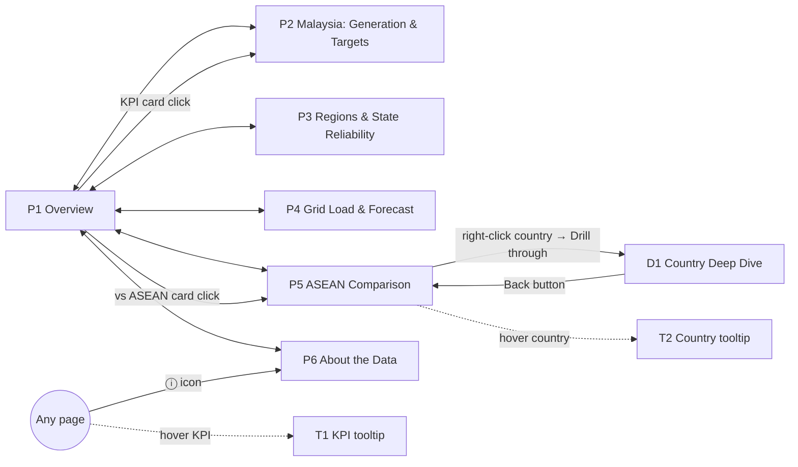
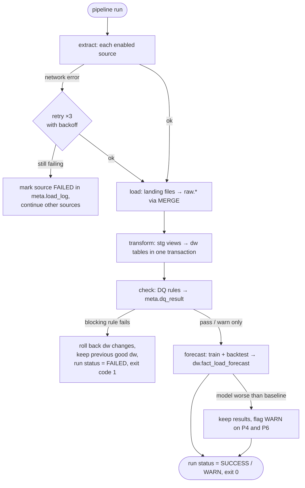

# 03 — App Flow: Malaysia Energy Transition Dashboard

**Status:** Approved 2026-09-30 · **Updated:** 2026-09-30 · **Builds on:** [01 PRD](01_Product_Requirements.md), [02 TRD](02_Technical_Requirements.md) (both Approved) · **Next:** 04 UI/UX Design Brief

> **How this document is adapted:** there's no app with screens and sign-in here. The "screens" are **Power BI report pages** (Part A). The "system flow" is the **pipeline run** (Part B). Part C covers the post-v1 Streamlit showcase. Visual styling and exact layout are doc 04's job; this document defines *what is on each page and what every control does*.
> Labels: **Decided** · **Recommended** · **Unverified** (as in docs 01–02).

---

# Part A — Report pages

## A1. Screen inventory

| ID | Page | Purpose | Reached from | Requirements |
|---|---|---|---|---|
| P1 | **Overview** | Answer the headline question in 10 seconds: latest KPIs, trend and NETR progress | Report opens here; "Home" button on every page | FR-06, FR-10 |
| P2 | **Malaysia: Generation & Targets** | How the mix changed; RE capacity vs NETR; capacity factor; demand growth | Nav rail; P1 KPI cards | FR-07, FR-10, FR-11 |
| P3 | **Regions** (as built, M4) | Peninsular vs Sabah vs Sarawak: capacity, consumption, interruptions, SAIFI | Nav rail | FR-23 |
| P3b | **State reliability** (split from P3, M4 Q5) | SAIFI/SAIDI by Peninsular state: map, ranked bar, selected-state trend | Nav rail | FR-24 |
| P4 | **Grid Load** | Daily load shapes, heatmap, peaks, load factor; Thailand ↔ Malaysia flows | Nav rail | FR-22, S2 |
| P4b | **Forecast** | Day-ahead forecast vs actual for a picked backtest day; backtest metrics and verdict | Nav rail | FR-13 |
| P5 | **ASEAN Comparison** | Malaysia vs peers on RE share, carbon intensity, per-capita demand; Malaysia's rank | Nav rail; P1 "vs ASEAN" card | FR-08, FR-09 |
| P6 | **About the Data** | Sources and licences, last refresh, data-quality results, KPI definitions, method notes | Nav rail; "ⓘ" icon on every page | FR-14, FR-05 |
| D1 | **Country Deep Dive** (hidden, drill-through) | The P2 view for any ASEAN country | Right-click a country on P5 → Drill through | FR-08 (**Recommended**, shows drill-through skill) |
| T1 | **KPI definition tooltip** (hidden) | Hover any KPI card → formula, unit, source | Hover on KPI cards (all pages) | NFR-03, FR-11 |
| T2 | **Country tooltip** (hidden) | Hover a country → mini mix bar and latest KPIs | Hover on P5 visuals | FR-08 |

## A2. Navigation map

All pages P1–P6 are also reachable from the left **nav rail** (doc 04 styles it). Page order in the nav rail = the interview demo order in doc 01 §4 (**Decided** as Recommended in doc 01).

## A3. Per page

Common to every page (**Recommended**): a header with the page title as a takeaway sentence, **"Data as of <last refresh date>"** (from `meta.load_log`), a **Reset filters** button, a **"ⓘ" About** icon, and the nav rail. These are not repeated in the tables below.

### P1 — Overview
**Layout, top to bottom:** header → row of 5 KPI cards → left: generation-mix trend (small stacked area, 2000–latest) · right: NETR progress (RE share of capacity vs 31% / 40% / 70% markers) → "Malaysia vs ASEAN" rank card → 3 headline findings (text, written after analysis) → source credit line.

| Element | User action | Result |
|---|---|---|
| KPI cards: Total generation (TWh), RE share (%), Fossil share (%), Carbon intensity (gCO₂/kWh), Demand per capita (MWh) | Hover | T1 tooltip: definition, formula, unit, source, YoY change |
| | Click | Navigate to P2 (page-navigation action) |
| "vs ASEAN" rank card ("Malaysia ranks N of 6 on RE share") | Click | Navigate to P5 |
| Mix trend chart | Hover | Year, TWh and % by source |
| NETR progress visual | Hover | Actual %, target %, gap in percentage points, target source citation |
| Year slicer (single year, default = latest complete year) | Change | All KPI cards and YoY deltas recompute for that year |

**States:** Loading: Power BI's native visual spinner (Import mode, expected < 3 s per NFR-01). Empty: a selected year with no data shows a "No data for <year>" message from a DAX measure, never a blank card. Error: if a refresh failed, the "Data as of" date shows the last good load, so stale data is visible, not hidden.
**Edge cases:** latest year is partial in Ember (monthly-backed estimate) → default year = latest *complete* year, with a footnote. YoY for the first year in range → "—", not 0%.

### P2 — Malaysia: Generation & Targets
**Layout:** header → toggle **TWh | %** → large stacked area: generation by source → row: RE share of **installed capacity** vs NETR targets (line + target markers) · **capacity factor by source** (bar, latest year) → demand growth as **two aligned single-axis charts** (annual demand TWh │ YoY growth %; per doc 04 F1, 2026-09-30) → footnotes.

| Element | User action | Result |
|---|---|---|
| TWh / % toggle (field parameter) | Click | Stacked area switches between absolute TWh and share % |
| Year-range slicer (between, synced across P2, P3, P5, D1) | Drag | All visuals filter to the range |
| Source slicer (coal, gas, hydro, solar, bioenergy, other) | Select | Filters the mix chart and capacity-factor bar; cross-filters others |
| Legend / series | Click | Highlights that source across visuals (cross-highlight) |
| Capacity-factor bar | Hover | CF = generation ÷ (capacity × 8,760 h), with inputs shown |
| NETR line | Hover | Actual vs target; target cites NETR source (doc 01 D6) |

**States:** Empty: a source filtered to a range with no generation → "No <source> generation in this period". Error/stale: as P1.
**Edge cases:** capacity missing for a year → CF shows blank with footnote "capacity not reported", never 0. Leap years → 8,784 h (handled in the DAX/SQL formula).

### P3 — Regions & State Reliability
**As built (M4, plan Q5): split into two pages**, P3 Regions and P3b State reliability, because one page needed ~640 px of the 568 px body. Original layout, kept for reference: header → region cards → state map + ranked bar → small multiples → SAIFI | SAIDI toggle → source credit + consent notice.

**P3 Regions:** header (takeaway title on the Sabah ÷ Peninsular SAIFI ratio) → 3 region cards (Peninsular / Sabah incl. Labuan / Sarawak: installed MW, available MW, consumption GWh, kWh per person, latest SAIFI; each card's subtitle gives its own years) → capacity mix by region (100% stacked column, source palette) · consumption by year (line) → SAIFI by region (bar, ratio in the title) · supply interruptions 2010–2022 (line) → note (Sarawak year mapping, Peninsular totals) → footnote (credit + consent notice).

**P3b State reliability:** header (worst and best state for the selected year and metric) → SAIFI | SAIDI tiles, year dropdown, CAIDI note → left: **Shape Map** (13 Peninsular states and territories, sequential blue) and the **selected-state trend** below it; right: **ranked bar** (all 13, rank 1 = most reliable, data labels) → footnote (credit + consent notice + ODbL credit).

| Element | User action | Result |
|---|---|---|
| Region cards (P3) | Click | **As built (Q9): no filter.** P3b holds only Peninsular states, so a region filter would empty it. The P3b map's grey "not reported" note points back to Regions instead |
| Metric toggle SAIFI / SAIDI (P3b) | Click | Map, bar, trend, titles and subtitle switch metric and unit (interruptions ↔ minutes per customer per year) |
| Map state / bar (P3b) | Click | Cross-filters the trend to that state, drawn against the Peninsular total. **As built:** one selected-state line replaces the small multiples (13 panels needed ~1080 × 340 px; M4 step 1 spike). Nothing selected = Peninsular alone |
| | Hover | State, value, rank, change vs 2015 |
| Year dropdown (P3b) | Change | Map and bar show that year; empty = the latest year. **As built (Q9): P3b's own control, not synced** with P1/P2/P5, whose years run to 2025 |

**States:** Empty: SAIDI not published for a state/year → "Not reported", greyed. **Consent notice** (**Decided** per doc 01 R3; **as built, M4 Q1**): both footers read "Source: Energy Commission, Malaysia Energy Statistics Handbook 2023 (pages)" followed by a measure on the D5 consent status. From 2026-10-07 (request sent, seed `REQUESTED`) it said "Derived charts for non-commercial portfolio use; written permission requested from the Energy Commission." **Since 2026-10-10** (consent granted 2026-10-09, seed `GRANTED`) it says "Charts adapted from the handbook with the Energy Commission's written permission (9 October 2026). Not endorsed by the Energy Commission.", which meets the consent's conditions (adapted charts identified, no endorsement implied).
**Edge cases:** state names differ between handbook editions (e.g. "WP Kuala Lumpur" vs "Kuala Lumpur") → normalised in `stg` via a state mapping table (doc 05). **Map visual (verified 2026-09-30; Decided):**
- Power BI **Shape Map** (now generally available; accepts a custom TopoJSON/GeoJSON file; [MS Learn](https://learn.microsoft.com/en-us/power-bi/visuals/desktop-shape-map)). It's used instead of the classic Filled Map, which Microsoft is deprecating in favour of Azure Maps ([MS Learn](https://learn.microsoft.com/en-us/azure/azure-maps/power-bi-visual-conversion)). Shape Map also renders offline with no map-service dependency.
- Boundaries: **geoBoundaries `MYS` ADM1 TopoJSON** (**as built:** the full-resolution file, 795,812 B, since geoBoundaries publishes the simplified version only as GeoJSON; registered in the report as a Shape Map resource with an explicit Mercator projection; joined on `shapeISO` = `dim_state.iso_3166_2`) (16 units: 13 states + 3 federal territories, 2017 boundaries). **ODbL 1.0**, derived from OpenStreetMap ([API record](https://www.geoboundaries.org/api/current/gbOpen/MYS/ADM1/)).
- Credit on P3b (as built; the map moved there) and P6: "Boundaries © OpenStreetMap contributors, via geoBoundaries (ODbL 1.0)".
- The state mapping table (doc 05) also maps handbook state names to the geoBoundaries shape names.
- Sabah and Sarawak shapes show "not reported" styling, since SAIFI by state covers Peninsular states only.

### P4 — Grid Load & Forecast
**Split into two pages (Amirul, M3 GUI round 1, 2026-10-04):** the six blocks below don't fit 1280×720 legibly. **P4 Grid load** holds the banner, load curve, heatmap, peak and load factor, and flows. **P4b Forecast** holds the banner, the backtest-day dropdown (2024 days only, nothing forced: no pick = the grid's 2024 peak day), the forecast chart, metric cards and verdict. Both pages have the grid selector, kept in step by slicer sync. The element table and states below apply across the pair.

**Layout:** header → **data-source banner** ("Showing: Thailand national grid (EGAT) · Open-data stand-in for Peninsular Malaysia…", or Singapore's "ASEAN peer grid", or "Peninsular Malaysia, GSO" once consented) → row: typical daily load curve (weekday vs weekend, by season) · hour × month **heatmap** → monthly peak demand (MW) and load factor (%) as **two aligned single-axis charts** (per doc 04 F1, 2026-09-30) → **forecast panel**: date picker for a backtest day → actual vs model vs baseline (line, 24 h) → metric cards: model MAPE, baseline MAPE, improvement % → **Thailand ↔ Malaysia interconnector flows** (the **daily mean net flow** in MW, signed so above 0 = Thailand exports, 2023–24, with the annual export and import GWh in the subtitle; from the Thailand dataset's `malaysia_IMP`/`malaysia_EXP`; one single-axis chart; hover shows the day and average MW; added per doc 05 review, 2026-09-30; daily per M3 Q3, because 17,544 hourly points exceed Power BI's line sampling) → method and limitations text.

| Element | User action | Result |
|---|---|---|
| Grid selector (Thailand / Singapore; Peninsular MY when consented) | Select | Whole page switches grid. Singapore added by the M3 grid search (Q4). Peninsular MY option is **hidden until GSO consent** (**Decided**) |
| Season / weekday-weekend toggle | Click | Load-curve lines switch: weekday vs weekend & holiday are the curve's two lines, and the season tile slicer narrows only the curve (a disconnected `season_pick` table), so the heatmap and peak charts stay whole-year |
| Heatmap cell | Hover | Hour, month, average MW |
| Date picker (backtest days only) | Pick | Forecast chart shows that day's actual, model and baseline |
| Metric cards | Hover | T1 tooltip: MAPE/MAE definition, backtest window |

**Verdict:** under the cards, the pre-committed decision (beats or does not beat the seasonal-naive baseline, with the 95% CI) and the pre-declared secondary statement against the weekday-aware naive (`docs/forecast.md`). With no day picked, the panel shows the grid's 2024 peak day.
**States:** Empty: date outside the backtest window → "Forecast available for <start>–<end>". Error: if the forecast step failed in the last run, the panel shows "Forecast not generated in latest run — see About page" (from `meta.load_log`).
**Edge cases:** Time zones differ (Thailand UTC+7, Malaysia UTC+8; neither uses daylight saving) → store UTC and local time explicitly (doc 05). Missing intervals in the source → shown as gaps, not interpolated in the chart. Interpolation is only used for model features, and is logged.

### P5 — ASEAN Comparison
**Layout:** header → country multi-select (default: MY, ID, TH, VN, PH, SG) → row: RE share trend (lines, **Malaysia highlighted**, others muted) · carbon intensity ranking (bar, latest year) → scatter: RE share (x) vs carbon intensity (y), bubble = demand → per-capita demand bar → rank card.

| Element | User action | Result |
|---|---|---|
| Country slicer | Select/deselect | All visuals and rank card recompute ("ranks N of <selected count>") |
| Any country mark | Hover | T2 country tooltip (mini mix bar, latest KPIs) |
| | Right-click → Drill through | D1 Country Deep Dive filtered to that country |
| | Click | Cross-highlight that country across visuals |
| Year-range slicer (synced) | Drag | Trends filter; ranking uses the range's last year |

**States:** Empty: fewer than 2 countries selected → "Select at least two countries to compare". Error/stale: as P1.
**Edge cases:** a peer's latest year missing (Ember coverage differs by country) → ranking uses the latest year **all selected** countries have, stated in a footnote.

### P6 — About the Data
**Layout:** header → sources table (name, what it gives, licence, link, last pulled) → last pipeline run summary (from `meta.load_log`: start, end, rows per source, status) → data-quality table (rule, source, status, rows affected; from `meta.dq_result`) → KPI definitions table → methodology notes (forecast method, capacity-factor formula, region/state mapping) → consent status (Energy Commission, GSO) → GitHub repo link.

| Element | User action | Result |
|---|---|---|
| Source links / repo link | Ctrl+click (Desktop) or click (PDF, web) | Opens in browser |
| DQ table row | Click | Filters the table to that source's rules |
| DQ status filter (Pass / Warn / Fail) | Select | Filters the table |

**States:** Empty DQ table (no run yet) → "No pipeline run recorded". Any **Fail** → red status chip and a count on the P6 nav icon (**Recommended**).

### D1 — Country Deep Dive (hidden, drill-through)
Same layout as P2 for one country, with no NETR panel (Malaysia-specific). **Back** button (top-left) → returns to P5 with its filters intact. Only reachable by drill-through; the title shows the country name.

### T1 / T2 — Tooltip pages (hidden)
T1: KPI name, definition, formula, unit, source, and latest vs previous value. T2: country name, flag-free label (**Recommended**: no flag images, to avoid asset licensing), mini generation-mix bar, RE share, carbon intensity.

## A4. Global behaviour
- **No sign-in**: the report is a local PBIP/PBIX. Only FR-19 (Publish to web) involves a Microsoft account.
- **Sync slicers:** the year-range slicer is synced across P2, P3, P5 and D1. P1 uses a single-year slicer, and P4 has its own date controls (**Recommended**).
- **Reset filters:** one bookmark per page restores defaults.
- **Back behaviour:** Power BI's native back button is only on D1. Elsewhere the nav rail handles movement.
- **Refresh:** manual. Run the pipeline (Part B), then Power BI **Home → Refresh**. There's no scheduled refresh (no Power BI Service).
- **Offline:** fully works offline once refreshed (Import mode).
- **Exports (FR-17):** PNG per page, **File → Export → PDF** (all visible pages; hidden pages D1/T1/T2 excluded), and a GIF/MP4 walkthrough following journey J2. **As built (M5):** `docs/img/01–09_*.png` and `docs/report.pdf` hold all 9 visible pages (Regions and State reliability joined on 2026-10-10, after the Energy Commission's consent; the walkthrough shows the other 7); the walkthrough is a 1:51 captioned MP4 (`docs/walkthrough_script.md`, "As recorded"), uploaded through GitHub's README editor when the repo goes public.

---

# Part B — Pipeline run flow

| Stage | Command | Success | Failure behaviour |
|---|---|---|---|
| Extract | `pipeline extract [--source X]` | New files in `data/raw/<source>/<date>/` | Retry ×3, then mark that source FAILED and continue the others. The run ends WARN. |
| Load | `pipeline load` | `raw.*` rows merged (no duplicates, FR-02) | Schema mismatch (the source changed its columns) → stop and log the diff. Nothing downstream runs. |
| Transform | (part of `run`) | `dw.*` rebuilt in one transaction | Error → transaction rolled back, previous `dw` kept |
| Check | `pipeline check` | All blocking rules pass | Blocking fail → roll back, exit 1 (FR-03). Non-blocking → WARN, shown on P6. |
| Forecast | `pipeline forecast` | Forecast + metrics written | Model worse than baseline → still written, flagged honestly |
| Export (post-v1) | `pipeline export` | Parquet snapshots for Streamlit | Excludes consent-restricted sources automatically |

**Source switches** in the config file (**Decided**): `gso.enabled = false` until TNB consents; `energy_commission.publish = false` (the repo holds only derived, credited charts until consent). **As built:** no config switch; D5's `consent_status` in `seed/data_source.csv` gates the exports (`tools/export_pages.py`), `GRANTED` since 2026-10-09.

---

# Part C — Post-v1 web showcase (FR-21), outline only
Streamlit multipage app mirroring P1, P2, P4, P5 and P6. P3 is included only if Energy Commission consent is granted. It uses a sidebar nav and the same takeaway-sentence titles, and reads Parquet snapshots. Detailed flow is to be written when FR-21 starts (after v1). **Recommended:** don't design it further now.

---

## End-to-end journeys

**J1 — Recruiter skim (no Power BI):** open GitHub repo → README hero image (P1 screenshot) → 3 findings → architecture diagram → (optional) PDF export. *Traces: P1 export, P6 content reused in README.*

**J2 — Interview demo (5 min):** P1 (read KPIs, hover one KPI → T1) → click KPI → P2 (toggle TWh/%, hover capacity factor) → P3 (switch SAIFI/SAIDI, click a state) → P4 (pick a backtest day; model vs baseline) → P5 (right-click Vietnam → D1 → Back) → P6 (show DQ table and reconciliation note). *Traces through P1–P6, D1, T1 with no gap.*

**J3 — Monthly refresh (you):** `pipeline run` → check exit code / P6 → Power BI Home → Refresh → check "Data as of" date → re-export PNG/PDF if numbers changed → commit.

**J4 — GSO consent arrives:** set `gso.enabled = true` → `pipeline run` → Power BI Refresh → P4 grid selector now shows "Peninsular Malaysia (GSO)" → update the README and P6 consent status.

**J5 — Fresh-clone reproduction (FR-18):** clone → follow README setup (install tools, create venv, `.env`) → `pipeline run` → open the PBIP → Refresh → P6 shows a successful run and passing DQ.

## Fixes & improvements
Not applicable: new project, nothing built yet.

## Open questions
Resolved in review 2026-09-30:
- **P3 map:** verified. Shape Map (GA) + geoBoundaries MYS ADM1 TopoJSON (ODbL 1.0, credited). See the P3 edge cases. **Decided.**
- **D1 drill-through:** keep. **Decided.**

Nothing open remains in this document.
