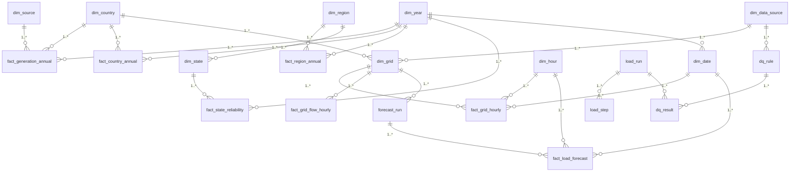

# 05 — Data Schema: Malaysia Energy Transition Dashboard

**Status:** Approved 2026-09-30 · **Updated:** 2026-09-30 · **Builds on:** [02 TRD](02_Technical_Requirements.md), [03 App Flow](03_App_Flow.md), [04 Design](04_UIUX_Design_Brief.md) (Approved) · **Next:** 06 Implementation Plan

> **Engine:** SQL Server 2025 (doc 02). Types below are real T-SQL types. The layout follows doc 02's layers: `raw` (source-shaped) → `stg` (views that clean and conform) → `dw` (star schema) → `mart` (views Power BI imports), plus `ref` (hand-authored seeds) and `meta` (run log, data quality).
> **Source columns were verified on 2026-09-30** by reading each file's real header (§1.1), so raw tables mirror what actually arrives.
> Labels: **Decided** · **Recommended** · **Unverified**.

## 1. Storage overview

| Where | What | Why |
|---|---|---|
| `data/raw/<source>/<YYYY-MM-DD>/` (disk, git-ignored) | Original downloaded files, untouched | Audit trail, and re-load without re-downloading. Git-ignored because D4/D5 can't be redistributed (doc 02 §7) |
| `EnergyDW.raw.*` | Source-shaped rows plus load metadata | Traceability: every `dw` number maps back to a raw row |
| `EnergyDW.stg.*` (views) | Type casting, unit normalisation, renames, state aliasing, unpivoting | Keeps cleaning logic in SQL: reviewable and part of the SQL showcase |
| `EnergyDW.dw.*` | Star schema: dimensions and facts | What analysts and Power BI model against |
| `EnergyDW.mart.*` (views) | One view per Power BI table, with only the columns the report uses | A stable contract between the database and the report |
| `EnergyDW.ref.*` | Hand-authored seeds (NETR targets, colours, KPI definitions, state aliases, source licences) | Loaded from `seed/*.csv` in the repo. Authored by us, so publishable |
| `EnergyDW.meta.*` | Run log, step log, DQ rules and results, schema version | FR-03, FR-05, and P6 "About the Data" |
| `exports/*.parquet` (post-v1) | Aggregated snapshots of `mart.*` for Streamlit | FR-21; licence-filtered by `dim_data_source.is_publishable` |

### 1.1 Verified source shapes
| Source | File / endpoint | Real columns (verified) | Grain | Coverage |
|---|---|---|---|---|
| D1 Ember yearly | `files.ember-energy.org/public-downloads/generation/outputs/release_generation_yearly_global.csv` (16 MB, global) | `Area, ISO 3 code, Year, Area type, Electricity source, Is aggregated source, Generation (TWh), Generation YoY change (TWh), Generation YoY change (%), Share of generation (%), Share of generation YoY change (% points), Capacity (GW), Emissions (MtCO2e), Emissions YoY change (MtCO2e), Emissions YoY change (%), Share of emissions (%), Emissions intensity (gCO2e/kWh), Continent, Ember region, EU member, OECD member, G20 member, G7 member, ASEAN member` | Area × year × source | Malaysia **1985–2025**; includes an `ASEAN` region row. Sources for Malaysia: Bioenergy, Coal, Gas, Hydro, Nuclear, Other fossil, Solar, Wind, plus aggregates (Clean, Fossil, Renewables, Total generation, …) and `Demand`, `Net imports` |
| D2 OWID | `owid-public.owid.io/data/energy/owid-energy-data.csv` | Used: `country, year, iso_code, population, per_capita_electricity, electricity_demand, electricity_generation, carbon_intensity_elec, renewables_share_elec, coal_/gas_/oil_/hydro_/solar_/wind_/biofuel_/other_renewable_electricity, greenhouse_gas_emissions` | Country × year | Long history; cross-check and population |
| D3 DOSM | `storage.data.gov.my/energy/electricity_supply.csv` and `…/electricity_consumption.csv` | `date, sector, supply` / `date, sector, consumption` (MKWh = GWh) | Month × sector | **Jan 2018 – Jun 2024 only**: the series has stopped (see Q2) |
| D-TH Thailand hourly | Zenodo record 17109911: `system_2023.csv`, `system_2024.csv` (CC BY 4.0) | `datetime` (dd/mm/yyyy h:mm), `north_/south_/metropolitan_/central_/northeast_` × `generation, demand`, `malaysia_IMP, malaysia_EXP, EDL_IMP, EDL_EXP, hongsa_IMP, cambodia_EXP` | Hourly (the first row of 2023 is stamped 0:05, which stg normalises) | 2023–2024 |
| D4 GSO (disabled until consent) | `gso.org.my/SystemData/SystemDemand.aspx/GetChartDataSource` | JSON `{DT, MW}` | 10-minute | ~Jan 2017 → present |
| D5 Energy Commission handbook | PDF tables, e.g. 2023 edition p.82–84 | Parsed to long form (row label × column label × value) | Year × region/state | SAIFI by state 2015–2022; regional supply performance 2010–2022 |

## 2. Entities

Conventions:
- Keys: surrogate `INT IDENTITY` for dimensions, except `year` (a natural `SMALLINT`) and `date_key` (`INT`, yyyymmdd).
- Decimals: `DECIMAL` for all measured quantities, never `FLOAT`, so reconciliation within ±0.5% is exact.
- Load columns on every raw table: `_run_id BIGINT NOT NULL` (FK → `meta.load_run`), `_source_file NVARCHAR(400) NOT NULL`, `_loaded_at DATETIME2(0) NOT NULL DEFAULT SYSUTCDATETIME()`.

### 2.1 `raw` — source-shaped (loaded by MERGE on the natural key, FR-02)

**`raw.ember_yearly`**, filtered on load to `ASEAN member = True` plus Area = `ASEAN` (the full 16 MB file stays on disk).
| Field | Type | Required | Default | Constraints / index | Notes |
|---|---|---|---|---|---|
| area | NVARCHAR(100) | ✓ | | PK part | e.g. `Malaysia`, `ASEAN` |
| iso3 | CHAR(3) | | NULL | | NULL for regions |
| year | SMALLINT | ✓ | | PK part | |
| area_type | NVARCHAR(40) | ✓ | | | `Country`, `Region` |
| electricity_source | NVARCHAR(80) | ✓ | | PK part | Ember's label, verbatim |
| is_aggregated_source | BIT | ✓ | | | |
| generation_twh | DECIMAL(12,4) | | NULL | | |
| share_of_generation_pct | DECIMAL(7,3) | | NULL | | |
| capacity_gw | DECIMAL(10,4) | | NULL | | Needed for capacity factor and RE capacity share |
| emissions_mtco2e | DECIMAL(12,4) | | NULL | | |
| emissions_intensity_gco2e_kwh | DECIMAL(10,3) | | NULL | | |
| *(YoY columns, share of emissions, region flags)* | DECIMAL / NVARCHAR / BIT | | NULL | | Kept verbatim; YoY is recomputed in SQL, not trusted |
| + load columns | | | | | |

PK: `(area, year, electricity_source)`.

**`raw.owid_energy`**: the columns listed in §1.1, filtered to the ASEAN ISO codes. PK `(iso_code, year)`. All measures `DECIMAL(14,4) NULL`; `population BIGINT NULL`.

**`raw.dosm_electricity`**: `month DATE ✓`, `sector NVARCHAR(40) ✓`, `measure NVARCHAR(20) ✓` (`supply`/`consumption`), `value_gwh DECIMAL(14,4) ✓`. PK `(month, sector, measure)`.

**`raw.grid_interval`**: one long table for all interval sources, so GSO plugs in without schema change (doc 02 §1).
| Field | Type | Required | Constraints | Notes |
|---|---|---|---|---|
| grid_code | VARCHAR(20) | ✓ | PK part | `TH_EGAT`, `SG_EMA`, later `MY_PEN_GSO` |
| source_file | VARCHAR(60) | ✓ | PK part | **M3 Q1:** raw is an exact copy of every file, so a day that appears in two files (Thailand's year-end spill-over) is kept twice, side by side |
| ts_text | VARCHAR(30) | ✓ | PK part | Timestamp exactly as the source wrote it |
| series | VARCHAR(40) | ✓ | PK part | e.g. `north_demand`, `malaysia_IMP`, `system_demand` (GSO) |
| value | DECIMAL(12,2) | | | MW; NULL where the source cell is blank |

**`raw.handbook_cell`**: generic long form for PDF tables.
| Field | Type | Required | Constraints | Notes |
|---|---|---|---|---|
| edition | SMALLINT | ✓ | PK part | Handbook year, e.g. 2023 |
| page | SMALLINT | ✓ | PK part | Pinned per edition (doc 02 §4) |
| table_code | VARCHAR(40) | ✓ | PK part | e.g. `SAIFI_BY_STATE` |
| row_pos | SMALLINT | ✓ | PK part | 1-based data row, top to bottom (**as built, M4 Q3**: positions, not labels, are the key, so duplicate printed labels such as p.13's repeated "IPPs" or Sarawak's two "2019" headers fit) |
| col_pos | SMALLINT | ✓ | PK part | 1-based value column, left to right |
| row_group | NVARCHAR(60) | | | Block the row sits in (p.13 region blocks) |
| row_label | NVARCHAR(150) | ✓ | | As printed, e.g. `Johor`; a wrapped label is joined with single spaces |
| col_label | NVARCHAR(60) | ✓ | | As printed, e.g. `2022` |
| value_text | NVARCHAR(40) | ✓ | | As printed (`-` kept); cast in stg. NOT NULL since V016 |
| _run_id, _source_file, _loaded_at | | ✓ | | Lineage, as in the other raw tables |

Runtime only: the D5 licence forbids committing these cells (M4 plan Q1, `DATA_LICENSES.md`).

### 2.2 `ref` — hand-authored seeds (from `seed/*.csv`, committed)
| Table | Fields (type) | PK | Purpose (doc 03/04 need) |
|---|---|---|---|
| `ref.source_map` | ember_source NVARCHAR(80), source_code VARCHAR(20), include_in_mix BIT | ember_source | Maps Ember labels to the 7 display slots. `Wind` → `WIND_OTHER_RE`; `Nuclear` → `OTHER_FOSSIL_OTHER` (doc 04 §3.2 fold rule); aggregates excluded |
| `ref.netr_target` | target_year SMALLINT, re_capacity_share_pct DECIMAL(5,2), source_url NVARCHAR(400) | target_year | 2025 = 31, 2035 = 40, 2050 = 70 (doc 01 D6) |
| `ref.state_alias` | alias NVARCHAR(100), state_code CHAR(3) | alias | "WP Kuala Lumpur" / "Kuala Lumpur" / "W.P. Kuala Lumpur" → `KUL` |
| `ref.kpi` | kpi_code VARCHAR(30), name, definition, formula NVARCHAR(400), unit NVARCHAR(20), polarity SMALLINT (+1 up=good, −1 down=good), source_code | kpi_code | T1 tooltip, P6 definitions, KPI delta colouring (doc 04 §3.5) |

### 2.3 `dw` — dimensions
| Table | Fields (type · constraint) | Notes / used by |
|---|---|---|
| **`dw.dim_country`** | country_key INT IDENTITY PK · iso3 CHAR(3) UNIQUE NULL · name NVARCHAR(100) NOT NULL UNIQUE · area_type VARCHAR(10) NOT NULL (`COUNTRY`/`REGION`) · is_asean BIT · is_focus BIT DEFAULT 0 (Malaysia = 1) · is_default_peer BIT (MY, ID, TH, VN, PH, SG) · display_order SMALLINT | P5 slicer defaults, Malaysia highlight (doc 04 §3.3), `ASEAN` aggregate row for benchmark |
| **`dw.dim_source`** | source_key INT IDENTITY PK · source_code VARCHAR(20) UNIQUE · display_name NVARCHAR(40) · group_name VARCHAR(10) (`FOSSIL`/`RENEWABLE`) · sort_order SMALLINT UNIQUE (1–7 = stacking order) · color_hex CHAR(7) · color_hex_dark CHAR(7) | Doc 04 §3.2 palette bound to the entity, so colour follows the source under any filter |
| **`dw.dim_year`** | year SMALLINT PK · is_complete BIT · decade SMALLINT | Annual facts. `is_complete` drives P1's "latest complete year" default |
| **`dw.dim_date`** | date_key INT PK (yyyymmdd) · date DATE UNIQUE · year SMALLINT FK→dim_year · month TINYINT · month_name CHAR(3) · iso_weekday TINYINT · is_weekend BIT · season_th VARCHAR(10) (`HOT`/`RAINY`/`COOL`) · season_my VARCHAR(12) (`NE_MONSOON`/`SW_MONSOON`/`INTER`) · is_holiday_th BIT · is_holiday_my BIT · is_holiday_sg BIT (V012) | P4 toggles; forecast features. Holidays from the `holidays` package at build (**Recommended**) |
| **`dw.dim_hour`** | hour TINYINT PK (0–23) · label CHAR(5) | P4 load curves, heatmap |
| **`dw.dim_grid`** | grid_key INT IDENTITY PK · grid_code VARCHAR(20) UNIQUE · name NVARCHAR(80) · country_key FK · utc_offset_min SMALLINT (TH 420, MY 480, SG 480) · data_source_code FK · is_published BIT | P4 grid selector. `MY_PEN_GSO.is_published = 0` until TNB consents (doc 03 P4) |
| **`dw.dim_region`** | region_key INT IDENTITY PK · region_code CHAR(3) UNIQUE (`PEN`,`SAB`,`SAR`) · name NVARCHAR(40) UNIQUE · display_order SMALLINT UNIQUE | P3 region cards. SAB includes Labuan (handbook p.18 note) |
| **`dw.dim_state`** | state_key INT IDENTITY PK · state_code CHAR(3) UNIQUE · name NVARCHAR(60) UNIQUE · geo_shape_name NVARCHAR(60) UNIQUE (exact geoBoundaries `shapeName`) · **iso_3166_2 CHAR(5) UNIQUE** (`MY-01`…`MY-16`, as built, M4 Q6) · region_key FK · is_federal_territory BIT · display_order SMALLINT UNIQUE. `mart.dim_state` adds is_reported_by_state (PEN states only) | P3b Shape Map joins on **`iso_3166_2`** (shapeISO; the step 1 spike showed it joins as well as the name and doesn't depend on spelling). 16 rows: 13 states + 3 federal territories |
| **`dw.dim_data_source`** | data_source_code VARCHAR(10) PK (`D1`…`D6`, `DTH`, `GEO`) · name · licence NVARCHAR(60) · url NVARCHAR(400) · credit_text NVARCHAR(400) · consent_status VARCHAR(20) (`OPEN`/`REQUESTED`/`GRANTED`/`REFUSED`) · is_publishable BIT | P6 sources table and consent status. Export filter (doc 02 §3.2) |

### 2.4 `dw` — facts
| Table | Grain / PK | Measures (type) | FKs | Used by |
|---|---|---|---|---|
| **`dw.fact_generation_annual`** | country × year × source · PK (country_key, year, source_key) | generation_twh DECIMAL(12,4) · share_pct DECIMAL(7,3) · capacity_gw DECIMAL(10,4) NULL · emissions_mtco2e DECIMAL(12,4) NULL | dim_country, dim_year, dim_source | P1, P2, D1 mix; capacity factor; RE capacity share |
| **`dw.fact_country_annual`** | country × year · PK (country_key, year) | total_generation_twh · demand_twh · net_imports_twh (DECIMAL(12,4)) · emissions_intensity_gco2e_kwh DECIMAL(10,3) · population BIGINT NULL · demand_per_capita_mwh DECIMAL(10,4) NULL · re_share_gen_pct · re_share_capacity_pct DECIMAL(7,3) NULL | dim_country, dim_year | P1 KPIs, P5, T2, NETR line |
| **`dw.fact_region_annual`** | region × year × metric · PK (region_key, year, metric_code) | value DECIMAL(14,3) NULL · unit NVARCHAR(30) · page SMALLINT (lineage). metric_code ∈ `INSTALLED_MW`, `AVAILABLE_MW`, `ELEC_CONSUMPTION_GWH`, `ELEC_PER_CAPITA_KWH`, `POPULATION_K`, `SUPPLY_INTERRUPTIONS`, `SAIFI`, `SAIDI_MIN` (CHECK) | dim_region, dim_year | P3 cards and charts (metrics vary by handbook table, hence long form). PEN SAIFI/SAIDI = the state tables' total rows (M4 Q4) |
| **`dw.fact_region_capacity`** (**as built, M4 step 2**) | region × year × source · PK (region_key, year, source_key) | installed_mw · available_mw DECIMAL(10,1) NULL (at least one set) | dim_region, dim_year, dim_source | P3 capacity mix by region. Split out because the long-form key can't hold a fuel breakdown without a NULL in the key; handbook fuels map to the doc 04 palette groups (M4 plan definitions) |
| **`dw.fact_state_reliability`** | state × year · PK (state_key, year) | saifi DECIMAL(6,3) NULL · saidi_min DECIMAL(8,2) NULL (NULL = "Not reported") | dim_state, dim_year | P3b map, ranked bar, selected-state trend (small multiples ruled out in the M4 spike) |
| **`dw.fact_grid_hourly`** | grid × UTC hour · PK (grid_key, ts_utc) | ts_local DATETIME2(0) · demand_mw DECIMAL(10,1) · is_imputed BIT DEFAULT 0 · date_key INT · hour TINYINT | dim_grid, dim_date, dim_hour | P4 curves, heatmap, peak, load factor; forecast input |
| **`dw.fact_grid_flow_hourly`** | grid × UTC hour × counterparty · PK (grid_key, ts_utc, counterparty) | import_mw DECIMAL(10,1) NULL · export_mw DECIMAL(10,1) NULL | dim_grid, dim_date, dim_hour | **Recommended new**: Thailand↔Malaysia interconnector flows (see Q1) |
| **`dw.fact_sector_monthly`** | month × sector × measure · PK (date_key, sector, measure) | value_gwh DECIMAL(14,4) | dim_date | DQ cross-check only (see Q2) |
| **`dw.forecast_run`** | PK model_run_id INT IDENTITY | grid_key FK · load_run_id FK · **run_kind** (`DEV` / `FINAL` / `POST_HOC`; one FINAL per grid, V013) · trained_at · model_name · train_start/train_end/test_start/test_end DATE (train_end = end of the last fold's training, V014) · mape_model · mape_baseline · mae_model · mae_baseline · improvement_pct · improvement_ci_low/high DECIMAL(8,3) · scored_hours · excluded_hours INT · params_json (the locked protocol) · metrics_json (per month, day type, secondary references, fingerprint) · git_commit · **protocol_commit** CHAR(40) · is_current BIT (never a DEV run) | dim_grid | P4 metric cards, verdict, backtest window |
| **`dw.fact_load_forecast`** | run × grid × UTC hour · PK (model_run_id, grid_key, ts_utc) | ts_local · actual_mw (NULL in a gap) · forecast_mw · baseline_mw DECIMAL(10,1) · is_scored BIT (actual, model and baseline all present) · date_key INT · hour TINYINT | forecast_run, dim_grid, dim_date, dim_hour | P4 actual vs model vs baseline |

**Derived in `stg`/`mart` (not stored):**
- Capacity factor = `generation_twh × 1000 / (capacity_gw × hours_in_year)`, with hours = 8,784 in leap years and 8,760 otherwise.
- Load factor = `AVG(demand_mw) / MAX(demand_mw)` per month.
- YoY deltas.
- Malaysia's rank.
- Thailand system demand = the sum of the 5 regional `_demand` series. **Unverified**: that the regional demands sum to national system demand. Checked at build against a published EGAT peak; if they don't reconcile, the page labels it "sum of regional demand".

### 2.5 `meta`
| Table | Fields (type) | Notes |
|---|---|---|
| `meta.load_run` | run_id BIGINT IDENTITY PK · started_at, finished_at DATETIME2(0) · status VARCHAR(10) CHECK IN (`RUNNING`,`SUCCESS`,`WARN`,`FAILED`) · git_commit CHAR(40) NULL · triggered_by NVARCHAR(60) | "Data as of" = MAX(finished_at) WHERE status IN (SUCCESS, WARN) (doc 03 A3) |
| `meta.load_step` | step_id BIGINT IDENTITY PK · run_id FK · data_source_code FK · stage VARCHAR(12) (`EXTRACT`/`LOAD`/`TRANSFORM`/`CHECK`/`FORECAST`/`EXPORT`) · status · rows_in INT · rows_merged INT · source_version NVARCHAR(100) (file date / ETag / edition) · message NVARCHAR(MAX) · started_at, finished_at | FR-05; P6 run summary |
| `meta.dq_rule` | rule_code VARCHAR(40) PK · description NVARCHAR(400) · data_source_code FK · severity VARCHAR(8) CHECK IN (`BLOCKING`,`WARN`) · check_sql NVARCHAR(MAX) (returns offending rows) | Seeded. Initial rules: no negative generation; mix shares per country-year sum to 100 ± 1; no missing years inside a country's range; capacity factor ≤ 1; hourly gaps ≤ 2%; Ember MY total vs OWID MY within ±5% (WARN); Ember vs DOSM annual supply within ±10% for 2018–2023 (WARN) |
| `meta.dq_result` | run_id FK · rule_code FK · status VARCHAR(4) (`PASS`/`WARN`/`FAIL`) · rows_affected INT · detail NVARCHAR(MAX) · checked_at DATETIME2(0) · PK (run_id, rule_code) | P6 DQ table, chip, nav badge |
| `meta.schema_version` | version INT PK · script_name NVARCHAR(200) · applied_at DATETIME2(0) · checksum CHAR(64) | Migration tracking (§5) |

### 2.6 `mart` views (the Power BI contract)
`mart.dim_country`, `mart.dim_source`, `mart.dim_year`, `mart.dim_date`, `mart.dim_hour`, `mart.dim_grid` (only `is_published = 1` grids), `mart.dim_region`, `mart.dim_state`, `mart.dim_data_source`, `mart.kpi`, `mart.netr_target`, `mart.generation_annual`, `mart.country_annual`, `mart.region_annual`, `mart.region_capacity`, `mart.state_reliability`, `mart.reliability_metric` and `mart.reliability_year` (disconnected P3b controls, M4), `mart.grid_hourly`, `mart.grid_flow_daily` (daily net flow, M3 Q3), `mart.forecast_date` and `mart.season_pick` (disconnected P4 controls), `mart.forecast_run_current`, `mart.load_forecast_current`, `mart.forecast_status`, `mart.run_latest`, `mart.dq_latest`. Each view selects explicit columns (no `SELECT *`), so a raw-schema change can't silently alter the report.

## 3. Relationships

- **Cardinality:** every dimension → fact relationship is one-to-many, and every fact row has exactly one row per dimension key (FKs `NOT NULL`).
- **Power BI:** the same relationships, all single-direction (dimension filters fact), plus a star per page. `dim_year` → `dim_date` exists in SQL for integrity, but in Power BI annual facts use `dim_year` and hourly facts use `dim_date` (no ambiguous paths).
- **Delete/cascade:** **no cascades** (**Decided**). Facts are rebuilt by a truncate-and-reload of `dw` inside one transaction (doc 03 Part B), so dimensions are never deleted while facts reference them. `meta` rows are append-only.

## 4. Authentication and authorisation
- **Method:** Windows integrated authentication only (doc 02 §7). There are no SQL logins or passwords.
- **Roles (**Recommended**, shows least-privilege practice):**
  - `role_pipeline`: rights on `raw`, `stg`, `dw`, `meta`, `ref`. Used by the Python pipeline.
  - `role_report_reader`: `SELECT` on `mart` only. Power BI connects under it.
  - On a single-user PC, both map to your Windows login. The grants live in migrations, so the pattern is visible in the repo.
- **Row-level security:** none, because all data is public and there's one viewer. If the report were shared through Power BI Service with restricted data (e.g. GSO data under a consent that limits who sees it), RLS on `dim_grid` would be the place to add it.

## 5. Data lifecycle
- **Migrations:** numbered, idempotent T-SQL scripts in `sql/migrations/V001__schemas.sql`, `V002__ref.sql` and so on, applied in order by `pipeline db migrate` and recorded in `meta.schema_version` with a checksum. Plain scripts are **Recommended** over Flyway or DACPAC: they're zero-install and readable in the repo.
- **Seeding:** `seed/*.csv` → `ref.*` and fixed dimensions (`dim_source`, `dim_country`, `dim_region`, `dim_state`, `dim_data_source`, `dim_hour`). `dim_date` and `dim_year` are generated in SQL.
- **Refresh pattern:**
  - `raw` is MERGEd by natural key, so a source revision overwrites the old value (Type-1). `source_version` in `meta.load_step` records which release was used.
  - `dw` is rebuilt from `stg` in one transaction per run, and rolled back if a BLOCKING DQ rule fails (doc 03 Part B).
- **Retention:** landing files keep the last 3 versions per source, pruned by the pipeline. `meta` is kept forever (tiny). Each `forecast_run` is kept; `is_current` flags the one the report shows.
- **Backup:** not needed, because the whole database is rebuildable from public sources plus seeds by `pipeline run` (FR-18). Optional `BACKUP DATABASE` before risky migrations.
- **Sync / offline conflicts:** not applicable. There's a single local writer, and Power BI Import mode works offline.
- **Licence gating:** `dim_data_source.is_publishable` controls `pipeline export` (post-v1). Rows from D4/D5 never leave the PC until consent flips the flag.

## 6. Sample records (synthetic: illustrative values, not real data)

| Table | Example row |
|---|---|
| `raw.ember_yearly` | area=`Malaysia`, iso3=`MYS`, year=`2024`, area_type=`Country`, electricity_source=`Solar`, is_aggregated_source=`0`, generation_twh=`9.1000`, share_of_generation_pct=`4.500`, capacity_gw=`4.9000`, emissions_mtco2e=`0.4000`, _run_id=`12` |
| `dw.dim_source` | source_key=`7`, source_code=`SOLAR`, display_name=`Solar`, group_name=`RENEWABLE`, sort_order=`7`, color_hex=`#eda100`, color_hex_dark=`#c98500` |
| `dw.fact_country_annual` | country_key=`1` (Malaysia), year=`2024`, total_generation_twh=`195.0000`, demand_twh=`194.0000`, emissions_intensity_gco2e_kwh=`560.000`, population=`35000000`, demand_per_capita_mwh=`5.5429`, re_share_gen_pct=`19.500`, re_share_capacity_pct=`27.000` |
| `dw.fact_state_reliability` | state_key=`1` (an example state), year=`2022`, saifi=`9.999`, saidi_min=`NULL` (deliberately impossible values; the handbook is restricted, so no real figure appears in this repo) |
| `dw.fact_grid_hourly` | grid_key=`1` (TH_EGAT), ts_utc=`2024-04-25 07:00:00`, ts_local=`2024-04-25 14:00:00`, demand_mw=`34850.0`, is_imputed=`0`, date_key=`20240425`, hour=`14` |
| `dw.forecast_run` | model_run_id=`7`, grid_key=`1`, run_kind=`FINAL`, model_name=`lightgbm`, train_start=`2023-01-08`, train_end=`2024-11-30`, test_start=`2024-01-01`, test_end=`2024-12-31`, mape_model=`3.309`, mape_baseline=`6.227`, improvement_pct=`46.864` (CI `39.324`–`52.849`), protocol_commit=`d7a03e2…`, is_current=`1`. The backtest is 12 monthly rolling origins across 2024 (M3 Q2), not a single Oct–Dec split |
| `meta.dq_result` | run_id=`12`, rule_code=`MIX_SUMS_TO_100`, status=`PASS`, rows_affected=`0`, checked_at=`2026-10-05 09:14:02` |

## 7. Fixes & improvements
| # | Item | Found in | Proposal |
|---|---|---|---|
| S1 | DOSM (D3) ends Jun 2024, and no page in doc 03 uses it | Header check, 2026-09-30 | Keep only as a WARN-level cross-check (Ember vs DOSM annual supply, 2018–2023), with no report page. Update doc 01 D3's role text accordingly (see Q2) |

## 8. Open questions
Resolved in review 2026-09-30:
- **Interconnector flows:** add to P4. **Decided.** `dw.fact_grid_flow_hourly` is confirmed, and doc 03 P4 has the new visual.
- **DOSM (S1):** demoted to a WARN-level cross-check only, with no report page. **Decided.** Doc 01 D3 role text updated.

Nothing open remains.
