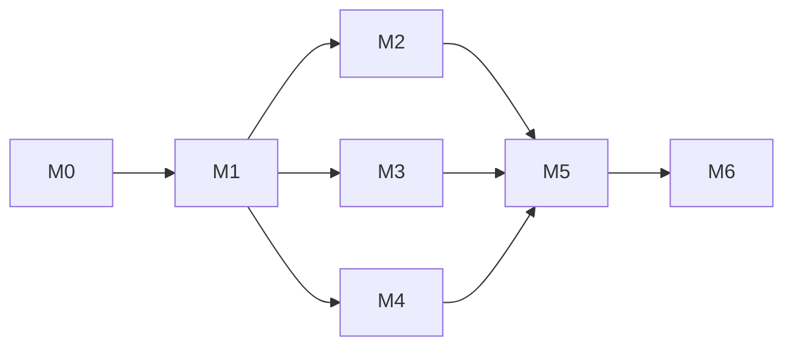

# 06 — Implementation Plan: Malaysia Energy Transition Dashboard

**Status:** Approved 2026-09-30 · **Updated:** 2026-09-30 · **Builds on:** docs [01](01_Product_Requirements.md)–[05](05_Data_Schema.md) (all Approved) · **Next:** build, only after your explicit go

> References like "doc 05 §2.4" point to the approved documents instead of restating them. Labels: **Decided** · **Recommended** · **Unverified**.

## 1. Current state
New project. Nothing is built yet. Evidence (2026-09-30):
- `Energy_Dashboard/` holds only `Documents/`.
- **Installed:** Git 2.51.1, Power BI Desktop 2.158.1177.0 (Store), winget, and Python 3.10.10 (end of life, not to be used).
- **Not installed:** SQL Server, SSMS, Python 3.13 (doc 02 §9).
- **Verified by hand during planning:** source headers (doc 05 §1.1), the GSO endpoint and its terms (doc 02 §11), and the palette validation (doc 04 §3.2).

## 2. Delivery milestones
| # | Milestone | Scope (FR ids) | Depends on | Status |
|---|---|---|---|---|
| **M0** | Environment, repo and consent request | T1, NFR-05; the GSO decision | — | pending |
| **M1** | **Vertical slice**: Ember → SQL Server → P1 Overview (thin) | FR-01, 02, 03 (3 rules), 04, 05, 06 (partial) | M0 | pending |
| **M2** | Malaysia and ASEAN analysis | FR-06, 07, 08, 09, 10, 11, 12, 15; D1, T1, T2 | M1 | pending |
| **M3** | Grid load and forecast | FR-13, 22; interconnector flows (S2) | M1 | pending |
| **M4** | Regions and state reliability | FR-23, 24 | M1 | pending |
| **M5** | Finish and ship **v1.0.0** | FR-14, 16, 17, 18, 20; NFR-01…08 | M2, M3, M4 | pending |
| **M6** | Post-v1 | FR-21 (Streamlit), FR-19 (optional), Energy Commission consent, GSO if consented | M5 | pending |

M2, M3 and M4 depend only on M1, so they can run in any order. **Recommended order:** M2 → M3 → M4, because it gets the headline story done first.

## 3. Phases and tasks
**Model** uses the routing rules in §4: **D** = Deep, **S** = Standard, **F** = Fast.
**Mirror** is the pattern to follow. This is a new project, so it points to a doc section or skill, not existing code.
**GUI** marks tasks that need Power BI Desktop or installers. These run in the **main session** (via computer use or your clicks), with the session model switched by `/model`, not in a subagent.

### Phase 0 — Environment and repo (M0)
| # | Task | Files | Mirror | Pri | Risk | Model | Verify | Size |
|---|---|---|---|---|---|---|---|---|
| 0.1 | Install Python 3.13 via winget; create `.venv`; install and pin packages (doc 02 §8) | `requirements.txt` | doc 02 §8 | P1 | Low | S | `.venv\Scripts\python --version` → 3.13.x; `pip check` clean | S |
| 0.2 | Install SQL Server 2025 Enterprise Developer + SSMS 22 (GUI, you click the UAC prompts); create database `EnergyDW` | — | doc 02 §5 | P1 | Medium | **S** ⚑ | `sqlcmd -S . -E -Q "SELECT @@VERSION"` shows 17.x; SSMS connects with Windows auth | M |
| 0.3 | Repo scaffold: `git init`, `.gitignore` (doc 02 §7), `.env.example`, folders (`pipeline/`, `sql/migrations/`, `sql/showcase/`, `seed/`, `report/`, `tests/`, `docs/`), MIT licence for code plus `DATA_LICENSES.md` | repo root | doc 02 §7 | P1 | Low | S | `git status` clean; `git check-ignore data/raw/x .env` both ignored | S |
| 0.4 | Draft the **TNB/GSO consent request** (purpose, non-commercial portfolio, attribution, no redistribution of raw data) as a Gmail **draft** for you to review and send | `docs/consent/gso_request.md` | GSO decision in doc 02 §11 | P1 | Medium | **S** ⚑ | You approve the wording; the draft appears in Gmail; `dim_data_source` D4 status → `REQUESTED` once sent | S |
| 0.5 | Create the GitHub repo `Aether03/malaysia-energy-transition-dashboard`, **private until v1** | — | — | P2 | Low | F | Remote set; first push succeeds | S |
| 0.6 | Confirm the model lineup ranking (does Fable 5.1 outrank Opus 5.5 for Deep work?) via the `claude-api` skill, and update §4 if so | this doc §4 | `claude-api` skill | P2 | Low | F | §4 table updated with a source | S |

⚑ **Overrides of the matrix (P1 × Medium = Deep → Standard):**
- **0.2:** the install is a guided, reversible vendor procedure, and failures show up immediately.
- **0.4:** you review every word before sending, which is itself the independent check.

### Phase 1 — Vertical slice (M1): small enough for 1–2 sessions
| # | Task | Files | Mirror | Pri | Risk | Model | Verify | Size |
|---|---|---|---|---|---|---|---|---|
| 1.1 | Migrations V001–V004: schemas, `meta.*`, `ref.*`, the annual dims and facts, the two roles | `sql/migrations/V00x__*.sql` | doc 05 §2, §4, §5 | P1 | **High** | D | Applies twice cleanly (idempotent); **review: `ecc:database-reviewer`** (check its T-SQL advice, as it's Postgres-leaning) | M |
| 1.2 | Seeds: `dim_source` (doc 04 palette), `dim_country`, `ref.source_map`, `ref.netr_target`, `ref.kpi`, `dim_data_source` | `seed/*.csv` | doc 05 §2.2–2.3 | P1 | Low | S | Row counts match; colours equal doc 04 §3.2 exactly | S |
| 1.3 | Pipeline skeleton: CLI (`python -m pipeline …`), config and `.env`, logging, `mssql-python` connection, migration runner with checksums, `meta.load_run`/`load_step` writer | `pipeline/cli.py`, `pipeline/db.py`, `pipeline/meta.py` | `ecc:python-patterns` | P1 | Medium | D | `pipeline db migrate` then `pipeline run --dry-run` writes one `load_run` row | M |
| 1.4 | Ember extractor + loader: download the yearly CSV, filter to ASEAN + `ASEAN`, MERGE into `raw.ember_yearly` | `pipeline/sources/ember.py` | doc 05 §2.1 | P1 | Medium | D | Run twice: row count unchanged (FR-02); `source_version` recorded | M |
| 1.5 | `stg` + `dw` transforms for `fact_generation_annual` and `fact_country_annual` (source mapping, capacity factor inputs, RE capacity share), in one transaction | `sql/transform/*.sql` | doc 05 §2.4 | P1 | **High** | D | DQ passes; **review: `ecc:database-reviewer`** + task 1.11 | M |
| 1.6 | DQ framework + first 3 BLOCKING rules (no negative generation, mix sums to 100 ± 1, no missing years); rollback on failure | `pipeline/dq.py`, `seed/dq_rule.csv` | doc 03 Part B | P1 | Medium | D | Inject a negative row: run exits 1 and `dw` is unchanged | M |
| 1.7 | `mart` views for M1 | `sql/mart/*.sql` | doc 05 §2.6 | P1 | Low | S | Views compile; no `SELECT *` (grep) | S |
| 1.8 | Unit tests: Ember parser and filter on a 50-row fixture | `tests/test_ember.py`, `tests/fixtures/` | `ecc:python-testing` | P2 | Low | F | `pytest` green | S |
| 1.9 | Power BI PBIP project: theme JSON (doc 04 §3.6), connection to `mart`, relationships (doc 05 §3), `_Measures` table (GUI) | `report/EnergyTransition.pbip`, `report/theme/energy-transition.json` | doc 04 §3.6 | P1 | Medium | D | Model view matches the doc 05 ER diagram; refresh succeeds | M |
| 1.10 | P1 Overview, thin version: 5 KPI cards, mix trend, NETR progress (GUI) | PBIR files | doc 03 P1, doc 04 §4 wireframe | P1 | Low | S | Screenshot matches the wireframe; empty-year message works | M |
| 1.11 | **Reconciliation:** 5 Malaysia figures (latest-year generation, RE share, carbon intensity, solar TWh, gas share) vs the Ember data explorer, within ±0.5% | `sql/showcase/00_reconciliation.sql`, `docs/reconciliation.md` | NFR-03 | P1 | **High** | D | All 5 within tolerance; **review: a fresh-context agent recomputes independently** | S |

**Deep reasons:**
- 1.1: migrations are irreversible-style schema work.
- 1.3, 1.4, 1.6: P1 × Medium per the matrix. This is the core pipeline that every later task builds on.
- 1.5, 1.11: numerical correctness.
- 1.9: the model layout is cross-cutting for every page.

**M1 acceptance:** on an empty database, `pipeline db migrate && pipeline run` exits 0, `meta.dq_result` is all PASS, task 1.11 passes, and P1 shows the latest complete year's KPIs.

### Phase 2 — Malaysia and ASEAN (M2)
| # | Task | Files | Mirror | Pri | Risk | Model | Verify | Size |
|---|---|---|---|---|---|---|---|---|
| 2.1 | OWID extractor/loader; population and per-capita into `fact_country_annual` | `pipeline/sources/owid.py` | task 1.4 | P1 | Medium | D | FR-02 re-run check; per-capita value hand-checked for MY | M |
| 2.2 | DAX measure library: shares, YoY with polarity, capacity factor (leap years), RE capacity share, rank, "No data" measures | TMDL `_Measures` | doc 03 A3, doc 04 §3.5 | P1 | **High** | D | Each measure equals its SQL showcase twin; **review: a fresh-context agent diffs DAX against SQL** | L |
| 2.3 | P2 Generation & Targets page, including the two aligned demand charts (F1) (GUI) | PBIR | doc 03 P2 | P1 | Low | S | Click-through of doc 03 P2's element table | M |
| 2.4 | P5 ASEAN page + T2 country tooltip (GUI) | PBIR | doc 03 P5 | P1 | Low | S | Rank card updates when countries are deselected | M |
| 2.5 | D1 drill-through + T1 KPI tooltip + Reset bookmarks + synced slicers (GUI) | PBIR | doc 03 D1, A4 | P2 | Low | F | Journey J2 from P5 → D1 → Back works | M |
| 2.6 | SQL showcase: trends, YoY with `LAG`, ranking with `RANK() OVER`, rolling averages; each query documented | `sql/showcase/0x_*.sql` | FR-15 | P1 | Medium | D | Outputs equal the P1/P2/P5 visuals for 3 spot values | M |
| 2.7 | DOSM loader + WARN cross-check rules (OWID ±5%, DOSM ±10%) | `pipeline/sources/dosm.py`, `seed/dq_rule.csv` | task 1.4 | P3 | Low | F | Rules appear in `dq_result` as PASS or WARN | S |
| 2.8 | Exploratory analysis → **3 headline findings**, each with a number, a caveat and a source query | `docs/findings.md` | doc 01 G2 | P1 | **High** | D | **Review: `audit-my-work`**, since these claims go public | M |

**Deep reasons:** 2.1 and 2.6 are P1 × Medium per the matrix; 2.2 is numerical correctness across the whole report; 2.8 makes public claims that must survive scrutiny.

**M2 acceptance:** J2 steps P1 → P2 → P5 → D1 work; all DAX/SQL twins match; findings are audited.

### Phase 3 — Grid load and forecast (M3)
| # | Task | Files | Mirror | Pri | Risk | Model | Verify | Size |
|---|---|---|---|---|---|---|---|---|
| 3.1 | Thailand hourly extractor (Zenodo 2023 + 2024) → `raw.grid_interval`, demand and flow series | `pipeline/sources/thailand.py` | task 1.4 | P1 | Medium | D | 2 × ~8,760 timestamps loaded; re-run idempotent | M |
| 3.2 | `stg` time handling: parse `dd/mm/yyyy h:mm`, normalise the 0:05 row, local→UTC (+7), sum regional demand, gaps and `is_imputed`; generate `dim_date` (holidays, seasons) and `dim_hour` | `sql/transform/grid_*.sql`, `pipeline/calendar.py` | doc 05 §2.3–2.4 | P1 | **High** | D | Gap report ≤ 2%; no duplicate UTC hours; **review: `ecc:python-reviewer` + `ecc:database-reviewer`** | M |
| 3.3 | Check the regional-sum-vs-national **Unverified** item against a published EGAT annual peak; set the P4 label | `docs/reconciliation.md` | doc 05 §2.4 | P2 | Medium | S | Documented result; label chosen | S |
| 3.4 | Forecast: features (calendar, lags ≥ 24 h), seasonal-naive baseline, LightGBM, rolling-origin backtest; write `forecast_run` + `fact_load_forecast` | `pipeline/forecast/*.py` | doc 02 §4 | P1 | **High** | D | MAPE vs baseline reported; **review: `ecc:mle-reviewer`** (leakage, split design) | L |
| 3.5 | Forecast tests: no feature uses future data, baseline equals the value from 168 h earlier, metrics on a toy series | `tests/test_forecast.py` | `ecc:python-testing` | P1 | Low | S | `pytest` green | S |
| 3.6 | P4 page: banner, load curves, heatmap, peak and load-factor charts (F1), forecast panel, metric cards, interconnector flows (S2) (GUI) | PBIR | doc 03 P4 | P1 | Low | S | Doc 03 P4 element table click-through | M |

**Deep reasons:** 3.1 is P1 × Medium per the matrix; 3.2 time handling and 3.4 model correctness are High (silent, costly errors).

**M3 acceptance:** the forecast beats the baseline, or P4 shows the honest WARN banner; the mle-reviewer findings are resolved.

### Phase 4 — Regions and state reliability (M4)
| # | Task | Files | Mirror | Pri | Risk | Model | Verify | Size |
|---|---|---|---|---|---|---|---|---|
| 4.1 | Handbook PDF extractor (`pdfplumber`) for SAIFI/SAIDI by state and the regional tables; pages pinned per edition; builds at runtime only (PDFs never committed) | `pipeline/sources/handbook.py` | doc 02 §4 | P1 | **High** | D | 2 years × all states match the PDF by eye; **review: a fresh-context agent re-reads the PDF pages** | L |
| 4.2 | `ref.state_alias`, `dim_state`/`dim_region` seeds; download geoBoundaries MYS ADM1 TopoJSON; verify `shapeName` values | `seed/*.csv`, `report/maps/mys_adm1.topojson` | doc 03 P3 | P1 | Low | S | All 16 shapes join; none unmatched | S |
| 4.3 | `stg`/`dw` for `fact_region_annual` and `fact_state_reliability` | `sql/transform/region_*.sql` | task 1.5 | P1 | Medium | D | Sample values equal the PDF; NULL where not reported | M |
| 4.4 | P3 page: region cards, Shape Map, ranked bar, small multiples, SAIFI/SAIDI toggle, consent footer, ODbL credit (GUI) | PBIR | doc 03 P3 | P1 | Low | S | Doc 03 P3 element table click-through | M |

**Deep reasons:** 4.1 parses numbers from a PDF, so errors are silent (High); 4.3 is P1 × Medium per the matrix.

**M4 acceptance:** P3 values match the handbook for 2 sample years, and the credits and consent notice are visible.

### Phase 5 — Finish and ship v1.0.0 (M5)
| # | Task | Files | Mirror | Pri | Risk | Model | Verify | Size |
|---|---|---|---|---|---|---|---|---|
| 5.1 | P6 About the Data: sources and licences, run summary, DQ table, KPI definitions, consent status (GUI) | PBIR | doc 03 P6 | P1 | Low | S | Every `dim_data_source` row shows its credit | M |
| 5.2 | Remaining DQ rules (hourly gaps, capacity factor ≤ 1) + the P6 nav badge on Fail | `seed/dq_rule.csv` | task 1.6 | P2 | Low | F | An injected fail shows the badge | S |
| 5.3 | Accessibility pass: alt text on every visual, tab order, Windows high-contrast check, digit alignment (doc 04 §2 **Unverified**); run `design:accessibility-review` on the PNGs | PBIR | doc 04 §7 | P2 | Medium | S | Checklist in `docs/a11y.md` all ticked | M |
| 5.4 | Exports: PNG per page (1280 × 720), PDF export, a ≤2-min walkthrough recorded by you with Snipping Tool following the J2 script (Claude writes the script) | `docs/img/`, `docs/report.pdf` | doc 03 A4 | P2 | Low | F | Files render on GitHub | S |
| 5.5 | README: the question, 3 findings, hero image, architecture diagram (doc 02 §1), setup, "How to explore", credits and licences | `README.md` | doc 01 FR-16 | P1 | Medium | D | A friend states the main finding within 30 s (doc 01 §5) | M |
| 5.6 | CI: GitHub Actions (`ruff`, `sqlfluff`, `pytest`) + Dependabot | `.github/workflows/ci.yml` | doc 02 §6 | P2 | Low | F | Green run on push; confirm Actions minutes (**Unverified** in doc 02) | S |
| 5.7 | Fresh-clone reproduction (FR-18) in a new folder with a new database, following only the README | — | doc 03 J5 | P1 | Medium | D | Completes in < 30 min (excluding installs); all DQ PASS | M |
| 5.8 | **Pre-publish audit:** secrets scan, `data/raw` and PDFs absent from Git history, licence credits complete, Energy Commission/GSO data not in any committed file | — | doc 02 §7 | P1 | **High** | D | **Review: `ecc:security-reviewer` + `audit-my-work` go/no-go** | M |
| 5.9 | Make the repo public (**asks you first**), tag `v1.0.0`, link it from the `Aether03` profile repo; you add it to LinkedIn Featured | — | — | P2 | Low | F | Public URL opens in a private window | S |

**Deep reasons:** 5.5 (public-facing, and attribution must be exact) and 5.7 are P1 × Medium per the matrix; 5.8 is High (security and licensing).

**M5 acceptance:** every **Must** in doc 01 passes its verification column, and the 5.8 verdict is "go".

### Phase 6 — Post-v1 (M6)
| # | Task | Files | Mirror | Pri | Risk | Model | Verify | Size |
|---|---|---|---|---|---|---|---|---|
| 6.1 | Draft the **Energy Commission consent** email (Gmail draft; you send it), per doc 01 R3 | `docs/consent/st_request.md` | task 0.4 | P2 | Medium | S | Draft approved; D5 status → `REQUESTED` | S |
| 6.2 | Streamlit web showcase (FR-21): `pipeline export` (licence-filtered Parquet), a multipage app mirroring P1/P2/P4/P5/P6, deployed on Community Cloud. Run `/plan` first | `app/`, `exports/` | doc 02 §3.2, doc 03 Part C | P2 | Medium | S | Public URL; 3 numbers match Power BI | L |
| 6.3 | Optional FR-19 "Publish to web" via the UiTM account **before it expires** (you sign in) | — | — | P3 | Low | F | Link opens logged-out | S |
| 6.4 | **If TNB consents:** build the GSO adapter (10-min → hourly), set `is_published = 1`, re-run the forecast on Peninsular data, update P4, README and P6 | `pipeline/sources/gso.py` | task 3.1 | P2 | **High** | D | Consent letter filed in `docs/consent/`; **review: `ecc:security-reviewer` (terms compliance) + `ecc:mle-reviewer`** | M |
| 6.5 | Optional monthly refresh via Windows Task Scheduler | — | doc 02 §4 | P3 | Low | F | Task runs once and logs to `meta` | S |

**Deep reason:** 6.4 is High (legal terms compliance, plus model re-validation on new data).

## 4. Model routing summary
| Tier | Model (this session's lineup) | Where it runs | Tasks |
|---|---|---|---|
| **Deep** | Opus 5.5 (`claude-opus-5-5`; Agent `model: "opus"`) | Main session for GUI and review-heavy work; subagents for code | **20**: 1.1, 1.3, 1.4, 1.5, 1.6, 1.9, 1.11, 2.1, 2.2, 2.6, 2.8, 3.1, 3.2, 3.4, 4.1, 4.3, 5.5, 5.7, 5.8, 6.4 |
| **Standard** | Sonnet 5.5 (`claude-sonnet-5-5`; `"sonnet"`) | Subagents, or the session after `/model` | **18**: 0.1, 0.2, 0.3, 0.4, 1.2, 1.7, 1.10, 2.3, 2.4, 3.3, 3.5, 3.6, 4.2, 4.4, 5.1, 5.3, 6.1, 6.2 |
| **Fast** | Haiku 4.5 (`claude-haiku-4-5-20251001`; `"haiku"`) | Subagents | **11**: 0.5, 0.6, 1.8, 2.5, 2.7, 5.2, 5.4, 5.6, 5.9, 6.3, 6.5 |

- **Unverified ranking:** Fable 5.1 (`claude-fable-5-1`) is also offered. Task 0.6 checks whether it should take the Deep tier.
- **Independent review** is required for the 10 High-risk tasks: 1.1, 1.5, 1.11, 2.2, 2.8, 3.2, 3.4, 4.1, 5.8, 6.4. The reviewer is named in each Verify cell and is always a different agent from the implementer.
- **Error controls in force:**
  - Each milestone is first detailed with `/plan` on Deep.
  - A task that fails verification twice moves up one tier.
  - Consecutive same-tier code tasks are batched into one subagent brief, with only the doc sections they cite.
  - GUI tasks (Power BI, installers) stay in the main session.

## 5. Fixes & improvements schedule
| Backlog item (index) | Placed in | Status |
|---|---|---|
| T1: Python 3.13 instead of 3.10 | Task 0.1 | Scheduled |
| F1: no dual-axis charts | Tasks 2.3, 3.6 | Docs done; built there |
| S1: DOSM as cross-check only | Task 2.7 | Docs done; built there |
| S2: interconnector flows visual | Tasks 3.1, 3.6 | Docs done; built there |
| **Unverified**: Segoe UI tabular digits | Task 5.3 | Scheduled |
| **Unverified**: TH regional sum vs national demand | Task 3.3 | Scheduled |
| **Unverified**: geoBoundaries `shapeName` values | Task 4.2 | Scheduled |
| **Unverified**: GitHub Actions allowances | Task 5.6 | Scheduled |
| **Unverified**: model ranking (Fable 5.1) | Task 0.6 | Scheduled |
| Singapore EMA as a second hourly source | — | **Deferred to v2**: licence unverified, and Thailand covers FR-22 |
| Weather features for the forecast | — | **Deferred to v2** (doc 02 §4) |

## 6. Testing strategy
| Level | What | Where | Runs |
|---|---|---|---|
| Unit | Parsers, time handling, calendar, forecast leakage | `tests/` (pytest) | Every commit (CI) |
| Data quality | BLOCKING and WARN rules (doc 05 §2.5) | `meta.dq_rule` | Every `pipeline run` |
| Reconciliation | 5 national figures within ±0.5%; DAX = SQL twins; handbook values = PDF | `sql/showcase/`, `docs/reconciliation.md` | End of M1, M2, M4 |
| Model | Rolling-origin backtest vs seasonal-naive baseline | `pipeline/forecast` | Every forecast run |
| Report | Per-page element click-through (doc 03 tables), journeys J1–J5 | Checklist | End of each page task and at M5 |
| Accessibility | doc 04 §7 checklist + `design:accessibility-review` | `docs/a11y.md` | M5 |
| Reproduction | Fresh-clone rebuild | Task 5.7 | M5 |

Milestone acceptance checks are listed under each phase.

## 7. Deployment and release steps
1. M0: create the repo **private**, and push on every milestone.
2. M5:
   - Task 5.8 audit reaches a "go".
   - Squash sensitive history if the audit finds anything, before going public.
   - Make the repo public (**with your explicit OK**).
   - Tag `v1.0.0` and write a GitHub Release with the PDF and PNGs attached.
3. Update the vault: `_Notes/Projects/Energy_Dashboard.md` (status, links) and `Home.md`.
4. M6: deploy Streamlit from the public repo (Community Cloud reads GitHub), and add the URL to the README and your portfolio site.
5. Later refreshes: follow journey J3, then tag a patch release (`v1.0.x`) when the numbers change.

## 8. Risks
| Risk | Likelihood | Impact | Mitigation |
|---|---|---|---|
| Power BI GUI work is slow through computer use | Medium | Medium | Claude edits PBIP/PBIR text files directly where possible; GUI is only for checks and layout nudges. You can do the fiddly drags yourself, following the spec. |
| PDF layout differs across handbook editions | Medium | Medium | Pin pages per edition (task 4.1); use the 2023 edition only if others break |
| Forecast fails to beat the baseline | Low | Medium | Honest WARN banner (doc 03 P4); it's still a valid ML story |
| SQL Server install trouble on Windows 11 | Low | High | Standard Developer edition as a fallback; installer logs checked at task 0.2 |
| Scope creep (Singapore, weather, prices) | Medium | Medium | Deferred list in §5; doc 01 non-goals |
| Usage limits during long build sessions | Medium | Low | Index plus milestone checklists let a cold session resume; batch subagents by tier |
| Consent refused (TNB or Energy Commission) | Medium | Low | Already designed around: open data default, consent-gated flags |

## 9. Open questions
Resolved in review 2026-09-30: the repo stays **private until the 5.8 audit**, then goes public with your OK (**Decided**). You record the walkthrough from Claude's script (**Decided**). Nothing open remains.
