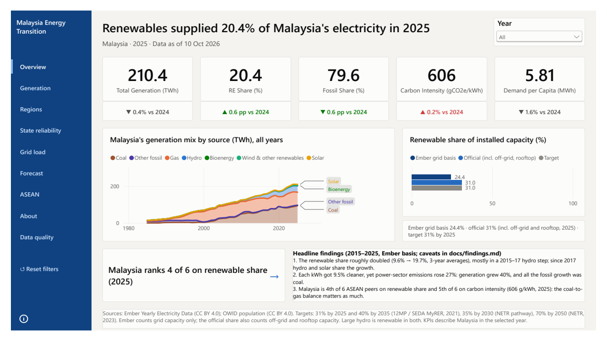
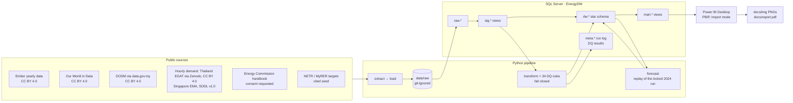

# Malaysia Energy Transition Dashboard

**How fast is Malaysia's electricity getting cleaner, and how does it compare with its ASEAN neighbours?**

## Findings (2015–2025, Ember release of 6 Oct 2026)

1. **The renewable share roughly doubled, mostly in one hydro-driven step.** Renewables' share of generation rose from **9.6% (2013–15 average) to 19.7% (2023–25)**, and reached **20.4% in 2025**. Most of the gain came in 2015–17, as new large hydro ramped up; since then hydro and solar have shared the growth.
2. **Each kWh got cleaner, yet power-sector emissions rose 27%.** Carbon intensity **fell 9.5% (669 → 606 gCO₂e/kWh)**, but **generation grew 40%**, so **emissions rose 27%**. All the fossil growth was coal: **coal output grew 49% while gas was flat**, and **coal is now 44.9% of generation**.
3. **Lower half on renewables, near the bottom on carbon intensity.** Among the six largest ASEAN power systems, Malaysia ranks **4th of 6 on renewable share** and **5th of 6 on carbon intensity**. The gap is mostly coal: Thailand's renewable share is only 1.3 points higher, yet its electricity is 80 g/kWh cleaner, because it runs mostly on gas while coal makes 45% of Malaysia's. The coal-to-gas balance matters as much as the renewable share.
4. **A day-ahead load forecast beats the standard baseline.** Tested once on all of 2024 under a protocol locked in advance, a LightGBM model cuts hourly error (MAPE) against the same hour last week by **46.9% for Thailand** and **34.5% for Singapore**.



Caveats, base-year choices and the query behind every number: [`docs/findings.md`](docs/findings.md). Forecast method and limits: [`docs/forecast.md`](docs/forecast.md). Every number above is re-checked against the warehouse by `tools/check_readme_numbers.py`.

## What it is

An end-to-end energy analytics project, built on public data with free tools on one Windows PC:

- **Python pipeline** that downloads six public sources, loads them into SQL Server and checks 34 data-quality rules on every run; a failing blocking rule rolls the load back.
- **SQL Server warehouse** in layers (`raw → stg → dw → mart`, plus `meta` for run logs and data-quality results), built by numbered migrations.
- **Power BI report** (PBIP, Import mode) of nine pages, with every key DAX measure checked against an SQL twin.
- **Day-ahead load forecast** (LightGBM), backtested once on 2024 under a pre-registered protocol and replayed identically on every run.



## How to explore

**Without Power BI:** the page images in [`docs/img/`](docs/img/) and the [PDF export](docs/report.pdf) show seven of the nine pages (see [Data and consent](#data-and-consent) for the other two).

| Page | What it shows |
|---|---|
| Overview | 2025 KPIs with change on 2024, the generation mix since 1985, renewable share of capacity against the national targets, the ASEAN rank, the headline findings |
| Generation | Generation by source (TWh or %), capacity targets to 2050, capacity factor by source, demand and its growth |
| Regions, State reliability | Peninsular vs Sabah vs Sarawak, and SAIFI/SAIDI by state (renders locally only, until the Energy Commission consents) |
| Grid load | Hourly load by month and hour, the typical day by season, monthly peaks and load factor, Thailand ↔ Malaysia interconnector flows |
| Forecast | Day-ahead forecast vs actual for any 2024 day, the backtest metrics and the verdict against the baseline |
| ASEAN | Malaysia against five peers on renewable share, carbon intensity and demand per capita; drill through to any country |
| About, Data quality | Sources, licences and consent status; the last run and every data-quality rule's result |

**In Power BI Desktop** (after [Setup](#setup)): buttons need **Ctrl+click** in Desktop. Click a KPI card on Overview to open its detail, hover a card for its definition and source, right-click a country on ASEAN → **Drill through**, pick a backtest day on Forecast, and click a source on Data quality to see its rules.

**The SQL:** [`sql/showcase/`](sql/showcase/) holds 14 commented queries (window functions, rolling averages, ranking on a common year, a growth decomposition, the forecast scored from the facts). Each starts with the question it answers and the values it should return.

## Setup

Under 30 minutes once the tools are installed. Windows 11 only (SQL Server and Power BI Desktop).

**Tools** (all free):
- SQL Server 2025 Developer edition (default instance, Windows authentication) and `sqlcmd`
- Python 3.13
- Git
- Power BI Desktop (Microsoft Store)

**Steps**, from a PowerShell prompt:

1. Clone with full history (the forecast replay reads its locked protocol from the commit it was recorded at, so don't use `--depth`). Clone into a folder whose path is under about 110 characters, such as `C:\src`: the repo folder adds 37 characters and its deepest file 108 more, and Windows limits paths to 260 unless long paths are enabled (otherwise the checkout fails with "Filename too long"):
   ```powershell
   git clone https://github.com/Aether03/malaysia-energy-transition-dashboard.git
   cd malaysia-energy-transition-dashboard
   ```
2. Create the virtual environment and install the pinned packages:
   ```powershell
   py -3.13 -m venv .venv
   .venv\Scripts\python -m pip install -r requirements.txt
   ```
3. Create the database and point the pipeline at it. `.env.example` holds the defaults (`localhost`, `EnergyDW`); no password is stored, since the pipeline uses Windows authentication. The connection trusts the server's self-signed certificate (`TrustServerCertificate=yes`), which is meant for a local instance, so keep `SQL_SERVER` on this PC:
   ```powershell
   copy .env.example .env
   sqlcmd -S localhost -E -Q "CREATE DATABASE EnergyDW"
   ```
4. Build the warehouse. `run` downloads every source (about 50 MB), transforms, runs the data-quality rules and replays the forecast. It exits 0 with four expected WARNs ([`docs/reconciliation.md`](docs/reconciliation.md)):
   ```powershell
   .venv\Scripts\python -m pipeline db migrate
   .venv\Scripts\python -m pipeline seed
   .venv\Scripts\python -m pipeline run
   ```
5. Open the report: double-click `report\EnergyTransition.pbip`, then **Home → Refresh**. If Desktop asks how to connect to SQL Server, choose **Windows → Use my current credentials**. If you used another server or database name in `.env`, set it first under **Transform data → Edit parameters**, then click **Apply changes** in the yellow bar that appears (this also loads the data). The **Data quality** page should show your run with 30 PASS, 4 WARN and 0 FAIL.

**Checks** (no database needed): `.venv\Scripts\python -m pytest -q` and `.venv\Scripts\python -m ruff check .`

**Close Power BI Desktop before `pipeline run` on a PC with 8 GB of RAM or less**: Desktop's engine and SQL Server compete for memory, and the transform slows from seconds to minutes.

## Data and consent

| Source | Licence | Used for |
|---|---|---|
| [Ember](https://ember-energy.org/data/yearly-electricity-data/) Yearly Electricity Data | [CC BY 4.0](https://creativecommons.org/licenses/by/4.0/) | Generation, capacity, emissions and demand for Malaysia and ASEAN |
| [Our World in Data](https://github.com/owid/energy-data) energy dataset | [CC BY 4.0](https://creativecommons.org/licenses/by/4.0/) | Population (per-capita demand), cross-checks |
| DOSM via [data.gov.my](https://data.gov.my) | [CC BY 4.0](https://creativecommons.org/licenses/by/4.0/) | Data-quality cross-check |
| Thai Power System dataset (Bunnak, 2025; EGAT data) via [Zenodo](https://doi.org/10.5281/zenodo.17109911) | [CC BY 4.0](https://creativecommons.org/licenses/by/4.0/) | Hourly load, forecast, interconnector flows |
| Energy Market Authority Singapore system demand | [Singapore Open Data Licence v1.0](https://www.ema.gov.sg/terms-of-use) | Hourly load and forecast |
| Energy Commission, Malaysia Energy Statistics Handbook 2023 | All rights reserved; written consent requested | Regions and State reliability pages (local only) |
| National RE targets (12MP / SEDA MyRER 2021, NETR 2023) | Cited facts | Target markers |
| geoBoundaries MYS ADM1 | [ODbL 1.0](https://opendatacommons.org/licenses/odbl/1-0/) | State boundaries: "© OpenStreetMap contributors, via geoBoundaries" |

All data are used modified (cleaned, reshaped, aggregated and combined into derived metrics), and no source endorses this project. Full terms and how each one is honoured: [`DATA_LICENSES.md`](DATA_LICENSES.md). Code: MIT ([`LICENSE`](LICENSE)).

- **Energy Commission handbook (D5).** Its copyright page requires written consent to reproduce any part. The pipeline downloads the public PDF at build time and nothing from it is committed, not even in test fixtures (a guard test and a value scan enforce this). Consent was requested on 7 October 2026. Until it is granted, the Regions and State reliability pages render only on your own machine and are left out of every published image, PDF and video, and the pages carry a "permission requested" notice.
- **Peninsular Malaysia hourly demand (GSO / TNB).** The Grid System Operator's terms forbid downloading or storing its data without TNB's written consent, which was requested on 30 September 2026 with no reply yet. The grid and forecast pages therefore use Thailand's open hourly data as a stand-in, and say so in a banner. The GSO adapter stays switched off until consent arrives.

## Limits

- **Ember basis.** Every Malaysia number uses Ember's grid generation and capacity. Recent Sabah and Sarawak figures are partly carried forward, 2025 capacity repeats 2024 for solar and hydro, and other sources disagree on Malaysia's generation by 6–14% in recent years (partly explained in [`docs/reconciliation.md`](docs/reconciliation.md)). Peer ranks can move with Ember's releases: its 6 Oct 2026 release revised Thailand's bioenergy upwards and moved Malaysia from 3rd to 4th on renewable share. `tools/check_readme_numbers.py` flags any such drift after a `pipeline run`.
- **Official vs Ember capacity share.** Malaysia's official renewable share of capacity was 31% at the end of 2025; Ember's grid basis gives 24.4%. The report shows both and explains the definition gap.
- **The forecast is for Thailand and Singapore, not Malaysia**, until GSO consents. It covers one test year; Thailand's hardest month is April (the Songkran holiday), and against a weekday-aware naive rule its margin is smaller (33.9%).
- **Static exports cut scrolling content.** Tables and lists that scroll show only their first rows in the PNGs and PDF (the sources, KPI definitions and data-quality rules on About and Data quality, the capacity-factor bars, the ASEAN country list); the full source list is above. Generation's main chart is only about 40 px tall, and three labels truncate ([`docs/a11y.md`](docs/a11y.md)).
- **Accessibility checks not done:** Windows high-contrast mode (skipped) and a screen-reader pass. Alt text, AA contrast, tab order and no-colour-only encoding are in place.
- **Power BI Desktop only.** There is no Power BI Service publication, so the report needs Windows, SQL Server and Desktop to run live; the images and PDF are the portable view.

## Repository map

| Path | Contents |
|---|---|
| `pipeline/` | The Python package: sources, migrations runner, transform, data-quality checks, forecast |
| `sql/` | Migrations, repeatable views, transform scripts, showcase queries |
| `seed/` | Reference data: countries, sources, KPI definitions, DQ rules, targets |
| `report/` | The Power BI project (PBIP: report JSON and TMDL model; no data) |
| `tools/` | Page builders, report validator, DAX-vs-SQL twin check, export and guard scripts |
| `tests/` | pytest suite (no database or Power BI needed) |
| `docs/` | Findings, forecast method, reconciliation, accessibility, page exports |
| `Documents/` | Planning documents (requirements, design, schema, plans per milestone) |
